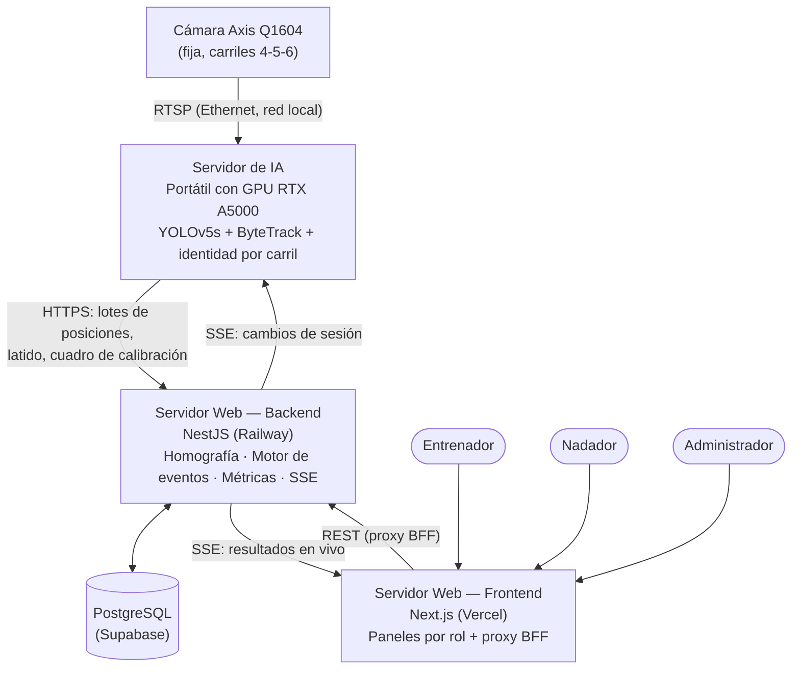
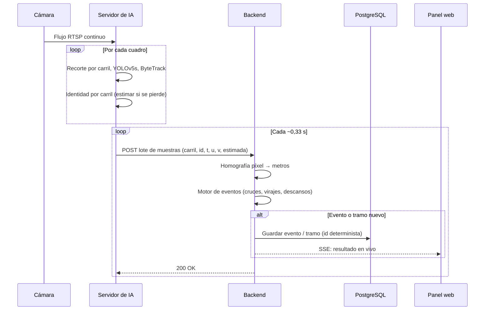
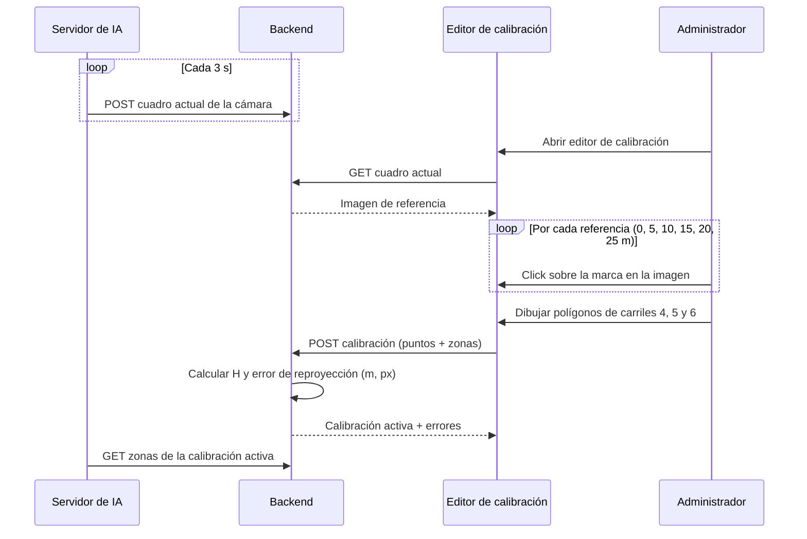
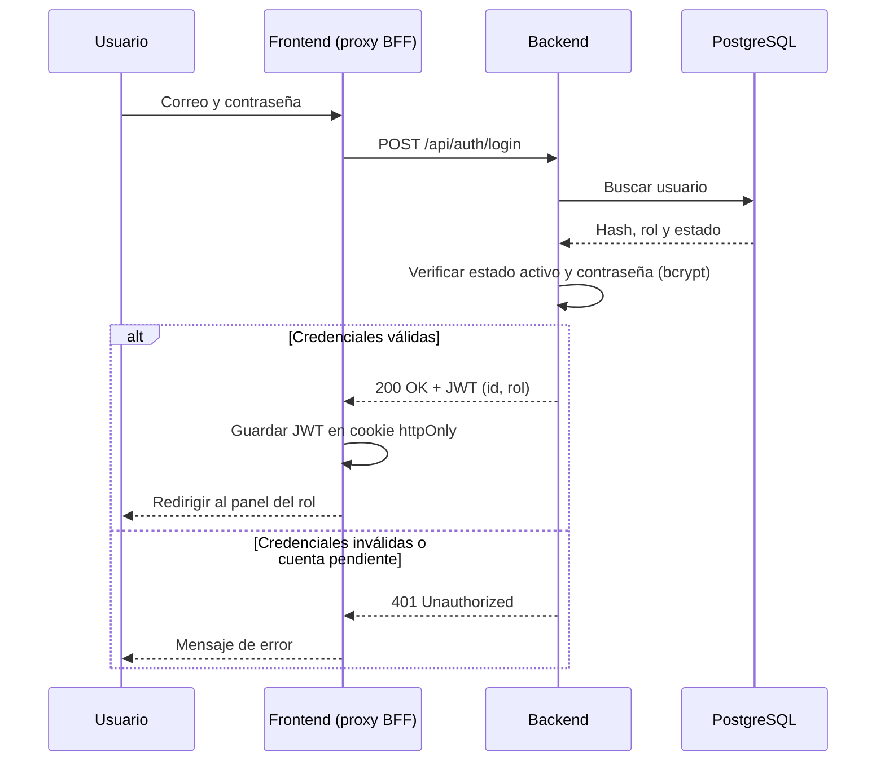
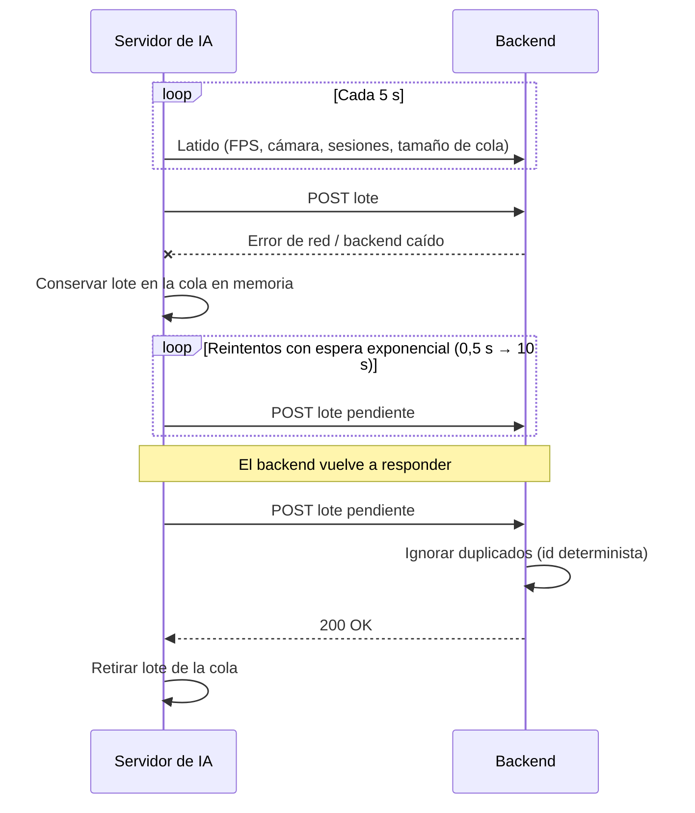
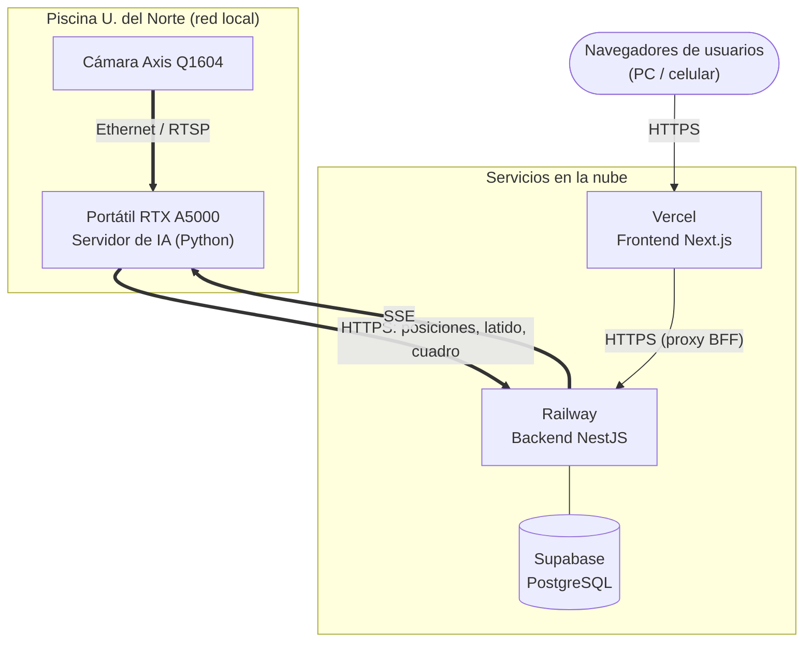

# Informe final — Safe Splash 2: sistema de monitoreo del rendimiento de nadadores mediante visión por computador

**Universidad del Norte**

**Curso:** Proyecto Final · **NRC:** 2367

**Integrantes:**

* Valentina Bella Mejia Gonzalez
* Kevin Jesus Torregrosa Padilla
* Luis David Robles Gonzalez

**Docente:** Augusto Salazar Silva · **Tutores:** Augusto Salazar Silva y Margarita Acosta Gamarra · **Fecha:** Noviembre de 2026

## Resumen / Abstract

El seguimiento del rendimiento en natación depende hoy en gran medida de la observación y el cronometraje manual del entrenador, lo que introduce imprecisiones y limita la construcción de un historial digital objetivo del deportista. **Safe Splash 2** es un sistema de visión por computador que, mediante una única cámara fija (Axis Q1604) instalada sobre los carriles 4, 5 y 6 de la piscina semiolímpica de la Universidad del Norte, detecta y sigue automáticamente a los nadadores sin sensores portátiles, identifica eventos de nado (paso por marcas cada 5 m, virajes y descansos) y calcula métricas como distancia recorrida, tiempo por tramo y por largo, velocidad promedio y ritmo.

La solución se organiza en dos componentes desacoplados. Un **Servidor de IA** en Python (YOLOv5s ajustado por transferencia de aprendizaje y ByteTrack) se ejecuta localmente en un computador portátil con GPU NVIDIA RTX A5000 conectado a la cámara. Un **Servidor Web** (backend NestJS en Railway, base de datos PostgreSQL en Supabase y frontend Next.js en Vercel) proyecta las posiciones a metros mediante homografía, ejecuta el motor de eventos, almacena los resultados y los muestra en vivo, con control de acceso por roles para administradores, entrenadores y nadadores. El desarrollo siguió un enfoque de prototipado iterativo validado con pruebas en la piscina.

Sobre un conjunto de prueba independiente de 750 imágenes, el detector obtuvo una precisión y un recall de 0,879, un mAP@0,5 de 0,911 y un mAP@0,5:0,95 de 0,563. En una sesión en vivo con dos nadadores simultáneos (carriles 5 y 6), el sistema registró 28 eventos, de los cuales 26 (93 %) fueron observados directamente por el detector, y los 12 tramos calculados se obtuvieron sin inferencia, con velocidades entre 0,59 y 1,03 m/s. En cuatro nados continuos de 200 m realizados por nadadores de la piscina, el error absoluto medio de los tiempos por tramo de 5 m frente a cronómetro manual fue de 1,53 s, dentro de la meta de 2 s. Dos entrenadores y ocho nadadores usaron la plataforma durante sesiones de al menos una hora y la calificaron con 4,4 de 5 estrellas en promedio. Los resultados muestran que una única cámara fija de bajo costo, junto con una arquitectura web desacoplada, permite obtener métricas de entrenamiento útiles en tiempo cercano al real dentro de la zona observada. Las principales limitaciones son las oclusiones cerca de la pared más cercana a la cámara, los reflejos en el extremo lejano y el supuesto de un nadador por carril.

## 1. Introducción

El entrenamiento deportivo de alto rendimiento se apoya cada vez más en tecnologías capaces de capturar información cuantitativa objetiva sobre el desempeño de los atletas, y la natación no es la excepción. En los últimos años, la visión por computador y el aprendizaje profundo han pasado de ser técnicas experimentales a convertirse en herramientas viables para el análisis deportivo: modelos de detección de objetos como la familia YOLO, combinados con algoritmos de seguimiento multiobjeto como ByteTrack o DeepSORT, permiten hoy detectar, seguir e interpretar el movimiento de personas dentro de un video sin necesidad de instrumentación física. En el ámbito de la natación en particular, el software cumple un rol cada vez más central como intermediario entre el gesto del deportista en el agua y la información que el entrenador necesita para tomar decisiones, sustituyendo progresivamente tareas que tradicionalmente exigían observación directa y registro manual.

A pesar de este avance tecnológico, la situación actual en la mayoría de los entornos de entrenamiento —incluida la piscina semiolímpica de la Universidad del Norte— sigue dependiendo casi por completo de la observación y el cronometraje manual. Esto obliga al entrenador a repartir su atención entre dirigir la sesión, cronometrar a los nadadores y registrar la información relevante, lo cual introduce errores humanos en el inicio y la parada del cronómetro y hace prácticamente inviable cronometrar con precisión a varios nadadores de forma simultánea. Además, la ausencia de un registro digital estructurado impide construir un historial de rendimiento que permita comparar sesiones, identificar tendencias y evaluar objetivamente la progresión del deportista a lo largo del tiempo, una carencia que afecta tanto a entrenadores, que pierden capacidad de análisis longitudinal, como a los propios nadadores, que no cuentan con retroalimentación cuantitativa sistemática de su evolución.

De esta situación se desprende una necesidad técnica concreta: contar con un mecanismo automático, no invasivo y de bajo costo de instrumentación, capaz de observar a los nadadores durante el entrenamiento y traducir ese video en métricas objetivas de desempeño. La oportunidad de diseño tecnológico consiste en aprovechar los avances recientes en detección y seguimiento de objetos —ya demostrados en otros contextos de natación con configuraciones de mayor infraestructura, como sistemas de ocho cámaras o de captura aérea mediante drones— para plantear una solución equivalente pero adaptada a una restricción real y frecuente en entornos universitarios: la disponibilidad de una única cámara fija que solo cubre una zona parcial de la piscina.

Sobre esta base surge **Safe Splash 2**, un sistema de visión por computador orientado al seguimiento automático de nadadores en la piscina semiolímpica de la Universidad del Norte mediante una cámara fija instalada sobre los carriles 4, 5 y 6. Sus funcionalidades clave incluyen la detección y el seguimiento del nadador mediante un modelo YOLO con tracking integrado, la identificación automática de eventos de nado y el cálculo de métricas como tiempo por vuelta, distancia recorrida, velocidad promedio y ritmo, todo ello accesible mediante una plataforma web con autenticación para administradores, entrenadores y nadadores. El impacto esperado es ofrecer una herramienta objetiva, escalable y de bajo costo de instrumentación que complemente —y no reemplace— el criterio del entrenador, sirviendo de base para las secciones siguientes, en las que se detalla el marco conceptual, el problema, el alcance, los objetivos, el diseño arquitectónico, la implementación y la validación del sistema.

## 2. Marco conceptual

### 2.1. Visión por computador

La visión por computador es el conjunto de técnicas utilizadas para obtener información de interés a partir de imágenes y videos. En el contexto de Safe Splash 2, constituye el componente encargado de transformar las imágenes capturadas por la cámara en información sobre la presencia, posición y desplazamiento de los nadadores.

La visión por computador resulta especialmente relevante en este proyecto porque permite realizar mediciones sin necesidad de instalar sensores directamente sobre el cuerpo del deportista. En investigaciones recientes de natación se han utilizado cámaras para detectar y analizar automáticamente el movimiento de los nadadores. Chern et al. (2025), por ejemplo, desarrollaron un sistema de análisis basado en video y aprendizaje automático para obtener información cuantitativa del desempeño.

### 2.2. Procesamiento de imágenes y video

El procesamiento de imágenes comprende las operaciones realizadas sobre los cuadros obtenidos por una cámara antes de ejecutar las etapas de detección y seguimiento. En una piscina, esta etapa puede ser importante debido a que los reflejos, las ondas, las salpicaduras y otros elementos visuales pueden generar información que dificulte la detección del nadador.

Por ello, Safe Splash 2 contempla operaciones de recorte de región de interés, estandarización del tamaño de entrada y corrección de perspectiva (mediante homografía) sobre las posiciones detectadas, considerando el ruido visual producido por el agua como una de las restricciones técnicas principales del dominio.

### 2.3. Detección de objetos

La detección de objetos consiste en localizar objetos dentro de una imagen y determinar su posición mediante regiones delimitadoras, normalmente conocidas como *bounding boxes*. En Safe Splash 2, el objeto de interés es el nadador (y, como clase auxiliar, la persona fuera del agua); el detector identifica su posición en cada cuadro del video para posteriormente proporcionar esta información al módulo de seguimiento.

Los modelos de la familia YOLO son especialmente relevantes para este problema porque fueron diseñados para realizar detección de objetos de manera eficiente. Además, investigaciones específicas sobre natación han utilizado YOLO adaptado al dominio para detectar nadadores; Chern et al. (2025) utilizaron YOLOv4 como modelo inicial y realizaron transferencia de aprendizaje utilizando más de 120.000 imágenes etiquetadas de nadadores.

### 2.4. YOLO y aprendizaje por transferencia

YOLO (*You Only Look Once*) corresponde a una familia de modelos de detección de objetos de una sola etapa que realizan la localización y clasificación de objetos directamente a partir de la imagen, en una sola pasada por la red (Jocher et al., 2020).

Una dificultad importante del proyecto consiste en que los nadadores presentan una apariencia diferente a las personas en escenarios terrestres: el cuerpo está parcialmente sumergido, deformado por la refracción del agua y rodeado de espuma y salpicaduras que generan ruido visual. Por esta razón, Safe Splash 2 utiliza aprendizaje por transferencia (*fine-tuning*), partiendo de un modelo YOLOv5 ya entrenado específicamente para detección de nadadores —los pesos públicos del repositorio DBDoco/yolo-swimmer-detection— y ajustándolo con datos propios capturados en la piscina de la Universidad del Norte, bajo el ángulo, la altura e iluminación reales de la instalación.

### 2.5. Seguimiento de objetos

La detección permite localizar un nadador en un cuadro determinado; el seguimiento de objetos busca mantener la correspondencia entre las detecciones de diferentes cuadros, permitiendo construir una trayectoria temporal del objeto. En Safe Splash 2, el seguimiento es indispensable porque las métricas no dependen únicamente de saber dónde está el nadador en un instante aislado, sino de conocer cómo cambia su posición a través del tiempo.

### 2.6. Seguimiento multiobjeto

El *Multiple Object Tracking* (MOT) consiste en localizar diferentes objetos y mantener una identidad asociada a cada uno a lo largo de una secuencia de video. Este concepto resulta relevante porque Safe Splash 2 contempla la presencia simultánea de varios nadadores dentro de la zona observada (hasta 3, uno por carril).

El seguimiento multiobjeto enfrenta problemas como pérdida de identidad (*ID switches*), fragmentación de trayectorias y oclusiones. Algoritmos modernos como ByteTrack fueron desarrollados precisamente para mejorar la asociación entre detecciones y trayectorias, aprovechando también detecciones de menor confianza para recuperar objetos que pueden encontrarse parcialmente ocultos.

### 2.7. ByteTrack

ByteTrack es un algoritmo de seguimiento multiobjeto propuesto por Zhang et al. (2022). Su principal característica es que no descarta automáticamente todas las detecciones que presentan una confianza baja; en lugar de ello, realiza una segunda etapa de asociación contra trayectorias existentes para recuperar objetos parcialmente ocluidos por salpicaduras o inmersiones breves.

Los autores reportaron resultados de 80,3 MOTA y 77,3 IDF1 en el conjunto general MOT17, con una velocidad cercana a 30 FPS utilizando una GPU V100. Estos valores corresponden a benchmarks generales de seguimiento sobre personas en entornos terrestres y no deben interpretarse como resultados esperados para Safe Splash 2.

### 2.8. Trayectoria

La trayectoria representa la evolución de la posición de un nadador a través del tiempo. Si el detector proporciona las coordenadas de la región delimitadora y el tracker mantiene la identidad del nadador, es posible construir una secuencia ordenada:

posición₁ → posición₂ → posición₃ → … → posiciónₙ

Esta trayectoria constituye la información fundamental para detectar desplazamientos, cruces de líneas de referencia y cambios de dirección.

### 2.9. Detección de eventos

Un evento corresponde a una situación identificable dentro de la trayectoria del nadador. En Safe Splash 2, los eventos se definen mediante nodos o líneas virtuales proyectadas sobre la piscina, tales como:

* entrada y salida de la zona observable;
* cruce de una marca de referencia cada 5 m;
* cambio de dirección o viraje contra la pared;
* inicio y finalización de un período de descanso.

Debido a que el detector puede perder momentáneamente al nadador (oclusiones, salpicaduras), el sistema distingue entre **eventos observados**, en los que al menos una de las muestras que rodean el cruce proviene de una detección real, y **eventos inferidos**, calculados a partir de posiciones estimadas por extrapolación acotada o separados por un hueco mayor a 1,5 s entre muestras. Esta distinción evita atribuir al sistema mediciones que la cámara no realizó directamente.

### 2.10. Calibración de cámara

La calibración permite establecer la relación matemática entre las coordenadas de la imagen y el espacio físico. Una imagen representa posiciones en píxeles, mientras que las métricas deportivas requieren unidades físicas en metros y segundos. La literatura sobre seguimiento de nadadores utiliza transformaciones geométricas proyectivas para calibrar videos y estimar desplazamiento y velocidad.

### 2.11. Homografía

La homografía es una transformación proyectiva entre dos planos (**H**, matriz de 3 × 3) que permite proyectar puntos identificados en la imagen (u, v) hacia un sistema de coordenadas asociado al plano de la superficie de la piscina (x, y), a partir de al menos cuatro pares de puntos no colineales cuya posición real es conocida:

$$
\begin{bmatrix} x' \\ y' \\ w' \end{bmatrix} = \mathbf{H} \begin{bmatrix} u \\ v \\ 1 \end{bmatrix}, \quad x = \frac{x'}{w'}, \quad y = \frac{y'}{w'}
$$

En Safe Splash 2, los puntos de referencia son las marcas ubicadas cada 5 m a lo largo de los carriles (0, 5, 10, 15, 20 y 25 m), cuya distancia al borde de salida es conocida. Cualquier error en la correspondencia entre píxeles y posiciones físicas se traslada directamente a las métricas de distancia y velocidad, por lo que la calibración se valida mediante su error de reproyección.

### 2.12. Distancia, velocidad y ritmo

Una vez obtenida la estimación de la posición del nadador en coordenadas físicas, se calculan las métricas de desempeño. La distancia recorrida *d* corresponde a la longitud del desplazamiento proyectado, y la velocidad promedio se calcula como:

$$
v = \frac{d}{\Delta t}
$$

donde *v* representa la velocidad promedio (m/s), *d* la distancia recorrida (m) y Δt el intervalo de tiempo transcurrido (s). El ritmo de entrenamiento se expresa como el tiempo requerido para recorrer 100 m (s/100 m).

### 2.13. Tiempo de descanso

El tiempo de descanso se estima identificando períodos durante los cuales la trayectoria del nadador permanece prácticamente estacionaria, con una velocidad por debajo de un umbral mínimo sostenida durante un intervalo de confirmación. Esto permite distinguir una pausa real de las pequeñas fluctuaciones de posición producidas por el oleaje o la varianza del detector.

### 2.14. Tiempo cercano al real

El término *near real-time* hace referencia a un sistema que procesa los datos con una latencia suficientemente baja para proporcionar información durante o inmediatamente después de la captura, sin exigir condiciones estrictas de tiempo real determinista cuadro a cuadro. Esta definición permite evaluar la latencia por tramo de 5 m.

### 2.15. Conceptos de arquitectura de software

* **API REST/JSON y SSE (*Server-Sent Events*):** comunicación cliente-servidor mediante peticiones HTTP estructuradas en JSON, complementada con un canal unidireccional persistente (SSE) que transmite resultados y estados en vivo hacia los paneles web.
* **Latido (*heartbeat*) y cola con reintentos:** señal periódica que reporta la disponibilidad del procesamiento de video; una cola temporal retiene muestras ante caídas de red y reintenta su envío mediante espera exponencial (*backoff*).
* **Control de acceso basado en roles (RBAC) con JWT:** autenticación con contraseñas protegidas mediante resumen criptográfico (*bcrypt*) y emisión de tokens firmados (*JSON Web Tokens*) que restringen el acceso según el perfil del usuario.
* **Arquitectura limpia (puertos y adaptadores):** separación entre las reglas de dominio (homografía, eventos, métricas) y los detalles de infraestructura (frameworks HTTP y base de datos).

## 3. Planteamiento del problema

### 3.1 Descripción del problema

En la piscina semiolímpica de la Universidad del Norte —al igual que en la mayoría de los entornos de entrenamiento de natación que no cuentan con infraestructura de análisis automatizado— el seguimiento del rendimiento de los nadadores depende casi exclusivamente de la observación directa y el cronometraje manual realizado por el entrenador. Esta situación no es un caso aislado, sino una carencia transferible a cualquier contexto de entrenamiento con recursos tecnológicos limitados: existen técnicas de visión por computador capaces de automatizar este análisis, pero no están siendo aprovechadas en la práctica cotidiana del entrenamiento.

Esta carencia se manifiesta de varias formas. En primer lugar, la carga cognitiva del entrenador se ve comprometida cuando debe simultáneamente dirigir la sesión, cronometrar y registrar datos, lo que le resta capacidad de atención a los aspectos cualitativos del entrenamiento. En segundo lugar, la precisión del cronometraje manual es limitada: los errores humanos en el inicio y la parada del cronómetro, sumados a la dificultad de cronometrar a múltiples nadadores de forma simultánea, introducen imprecisiones que pueden oscurecer la verdadera evolución del deportista. En tercer lugar, la falta de un registro digital estructurado impide construir un historial de rendimiento que permita comparar sesiones, identificar tendencias y evaluar objetivamente la progresión del nadador a lo largo del tiempo.

Las principales afectadas por esta carencia son dos poblaciones concretas: los entrenadores, que carecen de una herramienta objetiva y escalable para el análisis diario y la evaluación técnica, y los propios nadadores, que no reciben retroalimentación cuantitativa sistemática sobre su desempeño. La consecuencia directa es que las decisiones de entrenamiento —ajustes de ritmo, series, tiempos de descanso— terminan apoyándose en percepciones subjetivas en lugar de datos verificables, lo que limita la calidad del proceso de mejora deportiva.

### 3.2 Restricciones y supuestos de diseño

El planteamiento de la solución asume las siguientes restricciones y supuestos:

* **Cámara única (Axis Q1604) y campo visual parcial:** el sistema dispone de una sola cámara fija, montada sobre trípode a 2,5 m de altura junto a los carriles 4, 5 y 6 y conectada por Ethernet al equipo que ejecuta el Servidor de IA. No observa el resto de los carriles de la piscina.
* **Un nadador por carril:** se asume que en cada carril observado nada una sola persona durante una sesión. En las clases regulares de la piscina varios nadadores pueden compartir carril; para las pruebas se coordinó con la docente a cargo que hubiera un nadador por carril. Los datos de entrenamiento del detector, en cambio, se capturaron con la ocupación habitual de la piscina. Seguir a varios nadadores dentro de un mismo carril queda fuera del alcance por la complejidad que implica en un espacio tan reducido.
* **Disponibilidad de la piscina y de usuarios de prueba:** el desarrollo y la validación dependen de la disponibilidad de horarios de acceso a la piscina semiolímpica y de la colaboración voluntaria de nadadores y entrenadores para las pruebas de campo.
* **Recursos computacionales acotados:** el proyecto se desarrolla con los recursos de cómputo disponibles en un contexto académico. La inferencia se ejecuta localmente en un computador portátil con GPU NVIDIA RTX A5000 Laptop facilitado por la universidad, sin depender de servidores de cómputo en la nube.
* **Condiciones ambientales variables:** los reflejos, ondas, salpicaduras e iluminación cambiante sobre la lámina de agua pueden afectar la detección visual.
* **Calibración geométrica basada en referencias cada 5 m:** la correspondencia espacial se establece marcando manualmente sobre una captura de la cámara las posiciones físicas conocidas cada 5 m (0, 5, 10, 15, 20 y 25 m), asumiendo que la cámara permanece fija durante toda la sesión; si la cámara se reubica, se recalibra desde la plataforma web.
* **Tiempo de desarrollo acotado al calendario académico.**

### 3.3 Alcance

**Incluye**

* **Carriles declarados:** procesamiento de los tres carriles cubiertos desde el montaje a 2,5 m de altura (carriles 4, 5 y 6 de la piscina de 25 m).
* **Nadadores simultáneos:** detección y seguimiento de hasta 3 nadadores simultáneos, uno por carril observado.
* **Eventos comprometidos:** identificación automática del paso por los nodos de referencia ubicados cada 5 m, los virajes contra la pared dentro de los carriles cubiertos y los períodos de descanso en carril.
* **Métricas comprometidas:** cálculo de distancia recorrida, velocidad promedio por tramo y por sesión, tiempo por vuelta/largo, ritmo por 100 m y conteo de largos completos para los nadadores que permanecen en los carriles cubiertos.
* **Plataforma web multiusuario:** backend y frontend con autenticación y control de acceso por roles (administrador, entrenador, nadador), visualización en tiempo real, historial, comparación de sesiones, recalibración guiada de la cámara y exportación de reportes en formato PDF y CSV.

**No incluye**

* Cobertura de carriles distintos a los observados (carriles 1–3 y 7–8).
* Seguimiento de más de un nadador por carril.
* Detección automática por visión artificial del color de las boyas de la corchera (los nodos se definen geométricamente sobre la imagen calibrada).
* Persistencia en disco de las muestras en cola ante reinicios bruscos del proceso de IA (la cola opera en memoria).

## 4. Objetivos

### 4.1 Objetivo general

Diseñar e implementar un sistema inteligente basado en visión por computador que permita realizar el seguimiento automático de nadadores durante sus sesiones de entrenamiento en la piscina semiolímpica de la Universidad del Norte, mediante una única cámara calibrada contra las medidas físicas predefinidas de la piscina, registrando tiempos, recorridos e indicadores de desempeño que apoyen el análisis objetivo del entrenamiento por parte de entrenadores y deportistas.

### 4.2 Objetivos específicos

| N.º | Objetivo específico | Indicador de verificación |
| --- | --- | --- |
| OE-1 | Capturar y calibrar el video de entrenamiento mediante una cámara fija, estableciendo la correspondencia entre coordenadas de imagen y distancias reales a partir de las medidas estáticas predefinidas de la piscina (longitud de carril y nodos de color). | Error de reproyección de la homografía (m y px). |
| OE-2 | Preprocesar y estandarizar los frames capturados (redimensionamiento, corrección de distorsión de lente, corrección de iluminación, mejora de contraste, reducción de ruido, corrección de perspectiva y normalización), garantizando que únicamente frames estandarizados y validados sean enviados al modelo de inteligencia artificial. | Etapas de preprocesamiento aplicadas y desempeño del detector sobre los cuadros resultantes. |
| OE-3 | Detectar y realizar seguimiento (tracking) automático de máximo tres nadadores presentes en los carriles 4, 5 y 6 mediante un modelo YOLOv5 ajustado por transferencia de aprendizaje, combinado con ByteTrack, manteniendo la identidad de cada nadador durante toda la sesión, incluso ante oclusiones temporales o cambios de dirección. | Precisión, recall y mAP del detector; estabilidad de identidad por carril en sesiones reales. |
| OE-4 | Identificar automáticamente eventos de nado, tales como el inicio y fin de cada vuelta, cambios de dirección, períodos de descanso y finalización del entrenamiento. | Proporción de eventos observados frente a inferidos en sesiones reales. |
| OE-5 | Calcular métricas de desempeño por nadador —tiempo por vuelta, tiempo total, distancia recorrida, velocidad promedio, ritmo de entrenamiento, número de largos y tiempos de descanso— a partir de los datos generados por el módulo de tracking. | Error absoluto medio (MAE) < 2 s por tramo frente a una referencia de tiempo manual. |
| OE-6 | Diseñar una arquitectura de comunicación entre el Servidor de IA y el Servidor Web que permita el envío confiable de métricas, la validación de la información recibida y la sincronización del estado de ambos servicios (activo/inactivo, heartbeat). | Entrega sin pérdida ni duplicados ante fallos temporales de red. |
| OE-7 | Desarrollar una plataforma web (backend + frontend) que permita a entrenadores y nadadores visualizar estadísticas en tiempo real, consultar el historial de entrenamientos y comparar sesiones anteriores. | Flujos de historial, monitoreo en vivo y comparación operativos por rol. |
| OE-8 | Generar reportes de desempeño exportables en formato PDF y CSV, que resuman las métricas individuales y la evolución del rendimiento del nadador. | Archivos generados consistentes con los registros almacenados. |
| OE-9 | Gestionar los roles de usuario (administrador, entrenador, nadador) mediante un módulo de autenticación y autorización que restrinja el acceso a las funciones según el perfil correspondiente. | Respuestas de acceso (permitido/denegado) conformes a cada rol. |

## 5. Estado del arte / soluciones relacionadas

La literatura especializada muestra una evolución desde sistemas basados exclusivamente en sensores portátiles hacia soluciones capaces de utilizar video para realizar mediciones sin instrumentar físicamente al nadador. A continuación se presentan cinco antecedentes representativos, evaluados frente a los criterios de funcionalidad, escalabilidad, costo/infraestructura, usabilidad y limitaciones técnicas, seguidos de los vacíos identificados que justifican la propuesta de Safe Splash 2.

**Chern et al. (2025) — Sistema de análisis de estilo mariposa.** Desarrollaron un sistema inteligente para registrar y analizar el estilo mariposa mediante ocho cámaras (cuatro sobre el agua y cuatro bajo el agua) distribuidas a lo largo de una piscina de 25 metros, junto con acelerómetros. El modelo de reconocimiento fue entrenado mediante transfer learning sobre 120.031 imágenes etiquetadas, utilizando YOLOv4 como base, y alcanzó un IoU de 81,51 % y un error absoluto medio de 0,36 segundos en tiempos parciales. Es un antecedente clave por demostrar la viabilidad de YOLO en el dominio acuático, pero su infraestructura (ocho cámaras + sensores portátiles) es considerablemente mayor que la de Safe Splash 2, lo que limita su escalabilidad a contextos con recursos reducidos.

**Dronaquatics (Tran et al., 2026) — Análisis de natación con drones.** Sistema completamente basado en visión que utiliza imágenes aéreas capturadas por drones para eliminar la necesidad de dispositivos portátiles o equipos subacuáticos. Reportó un error de estimación de velocidad inferior al 4 % (menos de 0,05 m/s) y un error en tiempo por vuelta de 0,03 segundos. Ofrece alta funcionalidad y buena usabilidad de operación (un solo operador de dron), pero su escalabilidad está condicionada por la necesidad de personal capacitado para el vuelo del dron y por restricciones normativas de uso de drones en instalaciones cerradas, además de un costo de hardware mayor al de una cámara fija.

**SwimmerNET (Giulietti et al., 2023) — Estimación de pose subacuática.** Método sin marcadores para estimación de pose 2D bajo el agua mediante una única cámara gran angular de 8 Megapíxeles y redes neuronales completamente convolucionales, probado en los estilos libre, mariposa y espalda con un error promedio de ~1 mm y una desviación estándar de ~10 mm en el peor escenario. Es el antecedente más cercano a Safe Splash 2 en términos de infraestructura (cámara única), lo que respalda la viabilidad técnica de esta configuración; sin embargo, su enfoque está orientado a la estimación de pose biomecánica y no a métricas de desplazamiento agregadas por sesión, ni incorpora una plataforma web de consulta.

**SMU y SUTD (2025) — Análisis con drones para nadadores de élite.** Sistema desplegado en marzo de 2025 por investigadores de Singapore Management University y Singapore University of Technology and Design para el equipo nacional de natación de Singapur, que analiza en tiempo real duración de la brazada, velocidad de nado y simetría corporal segmentando el cuerpo del atleta en 17 puntos. Tiene alta funcionalidad y validación en contexto de alto rendimiento, pero de nuevo depende de un dron operado por personal especializado, lo que eleva su costo y limita su replicabilidad en entornos universitarios con recursos acotados.

**Proyectos de código abierto en GitHub.** YOLO-swimmer-detection (DBDoco) implementa detección de nadadores en Python con YOLO, un frontend HTTP simple y un servidor Flask; es, de hecho, el modelo base del cual parte el fine-tuning de Safe Splash 2 (sección 11). SwimmingStyleAnalysis (Sapna24Sangmitra, 2024) implementa un pipeline más completo basado en YOLOv8 que combina extracción de cuadros, detección, estimación de pose (YOLOv8-pose) y clasificación de estilo de nado, con suavizado temporal. Ambos son gratuitos y de bajo costo de infraestructura, lo que los hace altamente escalables, pero carecen de módulos de calibración física de la piscina, de cálculo de métricas de entrenamiento (tiempo por vuelta, distancia, ritmo) y de una plataforma web orientada a entrenadores y nadadores, quedándose en el nivel de prueba de concepto técnico.

| Sistema | Funcionalidad | Escalabilidad | Costo / infraestructura | Usabilidad | Limitaciones técnicas |
|---|---|---|---|---|---|
| Chern et al. (2025) | Tiempos parciales, conteo de brazadas, ángulos de rodilla | Baja (8 cámaras + acelerómetros) | Alto | Requiere instalación fija compleja | No aplicado fuera del estilo mariposa validado |
| Dronaquatics (2026) | Velocidad, tiempo por vuelta, conteo de brazadas | Media (requiere operador de dron) | Medio-alto | Buena una vez en vuelo | Restricciones normativas y de espacio para volar en piscinas cubiertas |
| SwimmerNET (2023) | Pose 2D detallada del nadador | Alta (cámara única) | Bajo | Orientado a análisis técnico especializado | No calcula métricas agregadas de sesión ni tiene interfaz web |
| SMU/SUTD (2025) | Brazada, velocidad, simetría corporal en tiempo real | Media (requiere dron y personal) | Alto | Alta en contexto de selección nacional | Difícil de replicar con recursos universitarios limitados |
| Proyectos open-source (DBDoco; Sapna24Sangmitra, 2024) | Detección de nadadores; detección + pose + clasificación de estilo | Alta (gratuitos, cámara única) | Muy bajo | Nivel de prototipo técnico, sin UI orientada a usuario final | Sin calibración física, sin métricas de entrenamiento ni plataforma web |

**Resultados esperados de la revisión.** La revisión evidencia que existen soluciones consolidadas para partes aisladas del problema —detección de nadadores, seguimiento de objetos (ByteTrack, DeepSORT), estimación de pose y cálculo de métricas de desplazamiento—, pero ninguna de ellas combina, con una única cámara fija de bajo costo, la calibración física de la piscina, el cálculo de métricas de entrenamiento orientadas al entrenador (tiempo por vuelta, distancia, ritmo, descansos) y una plataforma web con roles diferenciados para consulta histórica. Los sistemas con mayor precisión reportada (Chern et al., 2025; Dronaquatics, 2026; SMU/SUTD, 2025) dependen de infraestructuras de captura amplias (múltiples cámaras o drones) inviables en un entorno universitario típico, mientras que las soluciones de cámara única (SwimmerNET, 2023; proyectos open-source) no cubren el cálculo de métricas de entrenamiento ni la capa de aplicación web. Esta combinación de restricciones —cámara única, bajo costo y orientación a entrenamiento— constituye el vacío técnico que Safe Splash 2 busca atender, y su aporte no debe plantearse como la creación de un nuevo algoritmo de detección o tracking, sino como la integración y adaptación de técnicas existentes a un escenario específico con restricciones reales de hardware, campo visual y procesamiento.

## 6. Solución propuesta

**Safe Splash 2** implementa un sistema compuesto por una cámara fija, un **Servidor de IA** y un **Servidor Web** que trabajan de forma coordinada para transformar video en información útil de entrenamiento.

El **Servidor de IA** concentra el procesamiento visual y se ejecuta localmente en un computador portátil con GPU conectado a la cámara. Ingiere el flujo RTSP de la cámara fija, delimita los polígonos de los carriles 4, 5 y 6, detecta a los nadadores mediante un modelo YOLOv5s ajustado al dominio acuático, mantiene su trayectoria con ByteTrack, asigna una identidad estable por carril y envía lotes periódicos de muestras de posición (carril, identidad, marca temporal en milisegundos y coordenadas en píxeles) hacia el Servidor Web mediante una cola con reintentos y un latido de estado (*heartbeat*). El video nunca sale de la red local de la piscina; solo viajan posiciones.

El **Servidor Web** recibe dichas muestras, corrige la distorsión radial si está configurada, proyecta las coordenadas de píxeles a metros mediante la matriz de homografía calibrada, ejecuta el motor de eventos (cruces por los nodos cada 5 m, virajes en pared y períodos de descanso), calcula las métricas de desempeño (distancia, tiempo por tramo y por largo, velocidad promedio y ritmo), las almacena en PostgreSQL y las expone en tiempo real a través de una plataforma web con notificaciones en vivo (*Server-Sent Events*).

Los usuarios del sistema son tres: **nadadores**, que consultan su historial, evolución de desempeño y objetivos; **entrenadores**, que gestionan grupos, hacen seguimiento en vivo o histórico a los nadadores a su cargo, comparan sesiones y exportan reportes en PDF y CSV; y **administradores**, encargados de la gestión de usuarios, aprobación de entrenadores, configuración de la piscina, calibración espacial y supervisión de los servicios.

Esta solución responde al problema planteado porque automatiza las tareas que hoy recaen por completo en el entrenador —cronometraje, registro y cálculo de métricas— sin instrumentar al nadador ni requerir múltiples cámaras o drones, ajustándose a la restricción real de una sola cámara con cobertura parcial. Frente a las soluciones revisadas, su valor está en integrar en un mismo sistema la calibración física, las métricas orientadas al entrenamiento y una plataforma web con roles e historial. Además, ubicar la homografía y el motor de eventos en el Servidor Web mantiene liviano el pipeline de visión, centraliza las reglas deportivas en un único dominio y permite recalcular sesiones ante ajustes de calibración sin reprocesar el video.

## 7. Metodología de desarrollo

### 7.1 Enfoque y justificación

El desarrollo de Safe Splash 2 siguió un enfoque de **prototipado iterativo**, en el cual la solución se construyó mediante ciclos sucesivos de diseño, construcción, prueba y ajuste, en lugar de intentar entregar el sistema completo en una sola etapa. Esta elección respondió a la naturaleza incierta de varios componentes críticos —en particular, la precisión alcanzable del detector y del tracker en condiciones reales de la piscina, la estabilidad de la homografía desde una cámara lateral elevada y la viabilidad de procesar video en tiempo cercano al real—, por lo que resultó más apropiado validar supuestos técnicos en la piscina en cada ciclo antes de comprometer decisiones definitivas.

Este enfoque permitió, por ejemplo, descartar configuraciones de cámara que no ofrecían suficiente detalle en los carriles lejanos, elevar el montaje a 2,5 m para cubrir tres carriles en lugar de dos, y ajustar las reglas de identidad por carril y de estimación de posiciones tras observar pérdidas de identidad en las primeras grabaciones.

### 7.2 Iteraciones o fases de desarrollo

| Fase | Actividades principales | Artefactos resultantes | Estado |
| --- | --- | --- | --- |
| Fase 0 — Investigación y preparación | Definición de requerimientos, medición física de la piscina (longitud de carril y marcas cada 5 m), pruebas de montaje de cámara y revisión del estado del arte. | Documento de requerimientos, estado del arte y línea base técnica. | Completada |
| Fase 1 — Prototipo de detección | Construcción de un conjunto de datos propio de imágenes de nadadores en la piscina y ajuste fino de YOLOv5s. | Pesos entrenados del detector y evaluación sobre conjunto de prueba independiente. | Completada |
| Fase 2 — Tracking y motor de eventos | Incorporación de ByteTrack, asignación estable de identidad por carril, estimación acotada de posiciones y motor de eventos para cruces, virajes y descansos. | Módulos de seguimiento, identidad, trayectoria y motor de eventos. | Completada |
| Fase 3 — Calibración y cálculo de métricas | Homografía para transformar coordenadas de imagen a metros, editor visual de calibración y cálculo de métricas (tiempo, distancia, velocidad, ritmo y largos). | Servicios de homografía, evaluación de calibración y reconstrucción de largos. | Completada |
| Fase 4 — Arquitectura IA / Web | Canal HTTP/JSON entre servidores, cola con reintentos, latido periódico y persistencia relacional. | Módulos de envío, latido, publicación de cuadro y casos de uso de ingestión. | Completada |
| Fase 5 — Plataforma web | Backend NestJS y frontend Next.js, autenticación por roles, grupos, objetivos, historial, gráficas y exportación PDF/CSV. | API REST/SSE, interfaz web, 14 entidades y migraciones SQL. | Completada |
| Fase 6 — Integración y pruebas de campo | Despliegue en Railway, Vercel y Supabase; sesiones en vivo en la piscina con la cámara Axis y nadadores en los carriles observados; comparación contra cronómetro y pruebas con usuarios. | Sesiones registradas, mediciones de error y calificaciones de usuarios (sección 13). | Completada |

### 7.3 Estrategia de validación

La validación combinó estrategias complementarias acordes con cada capa del sistema:

* **Pruebas por componente:** verificación individual del detector (sobre un conjunto de prueba independiente), del tracker y la asignación de identidad (sobre grabaciones reales de la piscina), de la calibración por homografía (cruces registrados en todo el largo de 25 m) y del motor de eventos (sesiones reales).
* **Pruebas de integración:** sesiones completas en vivo en la piscina, desde la cámara hasta la visualización en la plataforma web, y verificación del acceso por rol y del comportamiento de la cola ante caídas del Servidor Web.
* **Comparación contra una referencia de tiempo:** contraste de los tiempos por tramo calculados por el sistema frente a tiempos medidos manualmente, empleando el error absoluto medio (MAE < 2 s) como métrica principal, siguiendo el precedente metodológico de Chern et al. (2025).
* **Retroalimentación de usuarios:** uso de la plataforma por entrenadores y nadadores en sesiones reales y calificación de la experiencia en una escala de 1 a 5 estrellas.

## 8. Requerimientos

### 8.1 Funcionales

* **RF-01:** El sistema debe capturar video en tiempo casi real desde la cámara fija instalada a 2.5 metros de altura sobre los tres carriles observados, transmitido mediante WebSocket al cliente que ejecuta la inferencia.
* **RF-02:** El sistema debe preprocesar cada cuadro capturado (redimensionamiento, corrección de distorsión de lente, corrección de iluminación y contraste, reducción de ruido, corrección de perspectiva y normalización) antes de enviarlo al detector.
* **RF-03:** El sistema debe detectar y seguir (tracking) a cada nadador presente en los tres carriles mediante YOLOv5 con ByteTrack, manteniendo su identidad durante toda la sesión.
* **RF-04:** El sistema debe identificar el instante en que cada nadador cruza uno de los nodos de color ubicados cada 5 metros en los divisores de carril.
* **RF-05:** El sistema debe calcular, a partir de los eventos de paso por nodo, la distancia recorrida y la velocidad promedio por tramo.
* **RF-06:** El sistema debe enviar las métricas calculadas por el Servidor de IA al Servidor Web para su almacenamiento, mediante REST push asíncrono.
* **RF-07:** El sistema debe permitir la autenticación de usuarios con tres roles diferenciados: administrador, entrenador y nadador.
* **RF-08:** El sistema debe permitir a los nadadores consultar su propio historial y evolución de desempeño.
* **RF-09:** El sistema debe permitir a los entrenadores hacer seguimiento a los nadadores a su cargo y generar reportes exportables en PDF y CSV.
* **RF-10:** El sistema debe permitir a los administradores gestionar usuarios y roles.
* **RF-11:** El sistema debe permitir recalibrar la posición de la cámara (homografía) mediante una interfaz guiada en el sitio web, sin requerir intervención de código.

### 8.2 No funcionales

* **RNF-01 (Desempeño):** el sistema debe operar en modo cercano al tiempo real (near real-time), evaluado por tramo de 5 metros y no cuadro a cuadro.
* **RNF-02 (Precisión):** el sistema debe apuntar a un error absoluto medio inferior a 2 segundos por tramo frente a un cronometraje manual de referencia.
* **RNF-03 (Recursos y portabilidad):** la inferencia del modelo se ejecuta en el dispositivo cliente (navegador), evitando la dependencia de GPU dedicada local; si las pruebas de campo muestran que el rendimiento en dispositivos cliente reales no alcanza el procesamiento cercano al tiempo real exigido por RNF-01, el equipo evaluará la alternativa de servidor en la nube documentada en la sección 9.4.
* **RNF-04 (Escalabilidad del MVP):** el sistema debe soportar de forma confiable hasta 3 nadadores simultáneos, uno por carril observado, en esta primera versión.
* **RNF-05 (Seguridad):** el módulo de autenticación debe restringir el acceso a las funciones del sistema según el rol del usuario (administrador, entrenador, nadador), y las credenciales deben almacenarse de forma cifrada.
* **RNF-06 (Disponibilidad):** ante la caída de alguno de los dos componentes, el sistema debe conservar las métricas ya calculadas mediante el mecanismo de heartbeat con buffer, en lugar de perderlas.
* **RNF-07 (Usabilidad):** la plataforma web debe permitir a entrenadores y nadadores consultar sus estadísticas, y recalibrar la cámara, sin requerir conocimientos técnicos previos.
* **RNF-08 (Mantenibilidad):** el Servidor de IA y el Servidor Web deben mantenerse como componentes desacoplados, comunicados mediante una interfaz definida, de modo que puedan modificarse, probarse o sustituirse de forma independiente.
* **RNF-09 (Portabilidad de red):** el sistema debe operar sobre la red local de la instalación (cámara → equipo de captura → dispositivo cliente), sin requerir conectividad a internet para el pipeline de video, reservando la conexión externa únicamente para la comunicación con el Servidor Web.

## 9. Evaluación de alternativas

Antes de definir cómo construir el sistema se evaluaron cuatro decisiones de arquitectura. Para cada una se presentan las opciones consideradas y la alternativa finalmente implementada.

### 9.1 ¿Cuál alternativa ofrece mejor desempeño bajo carga esperada?

Se evaluó cómo el Servidor de IA entrega los datos al Servidor Web: mediante solicitudes HTTP síncronas (REST push síncrono), mediante sondeo periódico del Servidor Web hacia la IA (*polling*), o mediante una cola intermedia de mensajería (como MQTT o RabbitMQ).

Una cola intermedia desacopla emisión y consumo, mientras que el *polling* introduce retardos acotados por el intervalo de consulta y el REST push síncrono bloquea la inferencia si la red tarda. Dado que Safe Splash 2 opera con un volumen acotado de datos (hasta 3 nadadores simultáneos), un broker externo añadía complejidad de infraestructura innecesaria.

**Alternativa seleccionada y contraste final:** se eligió **REST push asíncrono** (un hilo enviador desacoplado que agrupa muestras a ~3 Hz sin bloquear el ciclo de captura e inferencia), complementado con *heartbeat*. En la implementación final este canal transporta lotes de muestras de posición (t, u, v) en lugar de métricas ya calculadas, para que el backend ejecute la homografía y el motor de eventos de forma centralizada.

### 9.2 ¿Qué grado de acoplamiento introduce cada opción?

Se contrastó mantener dos componentes independientes (**Servidor de IA** y **Servidor Web**) frente a una aplicación monolítica donde el procesamiento de video y la plataforma web residieran en un único proceso.

En una arquitectura monolítica ambos conjuntos de responsabilidades comparten código, dependencias y ciclo de ejecución, lo que eleva el riesgo de que un cambio en el modelo o en la interfaz web afecte al resto. La separación permite actualizar o reentrenar el pipeline de visión (Python/PyTorch) sin modificar el backend web (Node.js/TypeScript), siempre que se respete el contrato JSON entre ambos.

**Alternativa seleccionada y contraste final:** se confirmó la **arquitectura de dos componentes independientes**. En producción, el Servidor de IA corre en el portátil conectado a la cámara y el Servidor Web en Railway y Vercel; en desarrollo, ambos se ejecutan como contenedores Docker en un mismo equipo. En los dos casos se comunican exclusivamente mediante API REST y SSE.

### 9.3 ¿Qué nivel de disponibilidad y tolerancia a fallos ofrece cada alternativa?

Se comparó operar sin tolerancia a fallos, implementar únicamente un *heartbeat* informativo, o combinar el *heartbeat* con almacenamiento temporal (buffer) en el Servidor de IA para retener datos durante indisponibilidades del Servidor Web. Dado que los registros de una sesión no pueden reconstruirse si no se almacena el video, perder información durante un microcorte compromete directamente el historial deportivo.

**Alternativa seleccionada y contraste final:** se implementó **heartbeat periódico con buffer local** en el Servidor de IA: un publicador reporta el estado cada 5 s, mientras una cola acotada (20.000 muestras) retiene lotes ante fallos de conexión y reintenta su entrega con espera exponencial entre 0,5 s y 10 s; el backend usa identificadores deterministas para evitar duplicados. Como limitación, la cola reside en memoria y no sobrevive a un reinicio abrupto del proceso de IA.

### 9.4 ¿Dónde debe ejecutarse la inferencia del modelo?

Se consideraron dos opciones: ejecutar el modelo directamente en el navegador del celular del entrenador, recibiendo el video desde la cámara, o enviar el video a un servidor remoto con GPU en la nube.

La opción del celular no tiene costo recurrente y no depende de internet, pero en las pruebas el navegador limitó demasiado el rendimiento del modelo para procesar tres carriles en tiempo cercano al real. La opción de la nube ofrece suficiente capacidad de cómputo, pero exige pagar de forma recurrente por una instancia con GPU durante sesiones de una a dos horas y depende de una conexión a internet estable y con suficiente ancho de banda para subir el video.

**Alternativa seleccionada:** una combinación de las ventajas de ambas. La inferencia se ejecuta en un computador con GPU, como en la nube, pero **local**, como en el celular: un portátil con GPU NVIDIA RTX A5000 Laptop facilitado por la universidad y conectado a la cámara por Ethernet. Así se obtiene la capacidad de cómputo necesaria sin costo recurrente y sin enviar el video fuera de la red de la piscina. La inferencia en el navegador se conservó como variante experimental (ONNX Runtime Web).

## 10. Diseño y arquitectura

### 10.1 Arquitectura

#### 10.1.1 Descripción general de la arquitectura

Safe Splash 2 adopta una **arquitectura cliente-servidor distribuida** organizada en dos componentes lógicos —el **Servidor de IA** y el **Servidor Web**— que se comunican mediante una API REST/JSON y canales de eventos SSE, apoyados por una base de datos PostgreSQL gestionada (Supabase). No es una arquitectura de microservicios: el backend concentra la lógica de negocio y la persistencia en un único servicio modular.

El enfoque general es separar lo pesado de lo persistente. El Servidor de IA, junto a la cámara, convierte el video en posiciones de nadadores y nunca envía video fuera de la red local. El Servidor Web convierte esas posiciones en eventos y métricas, las almacena y las muestra. Esta organización responde directamente a las alternativas seleccionadas en la sección 9: REST push asíncrono con lotes de posiciones (9.1), dos componentes desacoplados (9.2), heartbeat con buffer (9.3) e inferencia local con GPU (9.4).

Internamente, el backend aplica una **arquitectura por capas inspirada en puertos y adaptadores**, que aísla los servicios de dominio (homografía, motor de eventos y cálculo de largos) de los controladores HTTP y del mapeador objeto-relacional (Prisma).

#### 10.1.2 Componentes del sistema e interacción

##### 10.1.2.1 Descripción de componentes

| Componente | Responsabilidad principal | Requerimientos | Tecnología |
| --- | --- | --- | --- |
| Cámara | Captura del video de los carriles 4, 5 y 6 y emisión del flujo RTSP por Ethernet. | RF-01 | Axis Q1604 |
| Servidor de IA | Captura del flujo, recorte por zonas de carril, detección, seguimiento, identidad por carril, envío de muestras, latido y cuadro de calibración. | RF-01 a RF-03, RF-06, RNF-01, RNF-03, RNF-04, RNF-06, RNF-09 | Python 3.11, PyTorch (CUDA), YOLOv5s, ByteTrack (boxmot), OpenCV; portátil con GPU RTX A5000 |
| Servidor Web: backend | Autenticación y RBAC, sesiones, calibración y homografía, motor de eventos, tramos y largos, difusión SSE y persistencia. | RF-04 a RF-11, RNF-05, RNF-06, RNF-08 | NestJS 11, Prisma 7, JWT, *bcrypt*; desplegado en Railway |
| Base de datos | Usuarios, calibraciones, sesiones, eventos, tramos, grupos, objetivos y latidos. | RF-06, RF-08, RF-09 | PostgreSQL en Supabase |
| Servidor Web: frontend | Interfaz por rol, proxy BFF hacia la API con cookies seguras, monitoreo en vivo, gráficas, editor de calibración, historial y exportación de reportes PDF y CSV. | RF-07 a RF-11, RNF-07 | Next.js 16, React 19, TypeScript, Tailwind CSS 4; desplegado en Vercel |
| Variante móvil (experimental) | Transmisión de cuadros JPEG por WebSocket hacia el navegador, que ejecuta inferencia ONNX y envía posiciones. | RF-03 (variante) | Python, WebSockets, ONNX Runtime Web |

**Figura 1 — Diagrama de arquitectura del sistema.** Muestra los actores, los componentes principales y los canales de comunicación entre ellos.

##### 10.1.2.2 Interacción entre módulos

**Comunicación y flujos de datos.**

1. **Cámara → Servidor de IA:** transmisión continua de video por RTSP sobre Ethernet, dentro de la red local de la piscina.
2. **Servidor de IA → Backend:** envío de lotes de posiciones por HTTP POST al recurso de trayectorias de la sesión. Además, la IA consulta los polígonos de carril de la calibración activa, escucha los cambios de sesión por SSE (con consulta periódica de respaldo), publica un cuadro para calibración cada 3 s y reporta su estado cada 5 s.
3. **Backend → Base de datos:** el adaptador Prisma persiste sesiones, eventos y tramos en PostgreSQL.
4. **Backend → Clientes web:** el canal SSE emite en tiempo real el estado del sistema, el inicio y cierre de sesiones, los resultados calculados, la disponibilidad de carriles y el latido.
5. **Navegador → Proxy del frontend → Backend:** el proxy de Next.js convierte la cookie de sesión en una cabecera *Bearer* y reenvía la petición, ocultando la dirección del backend.

Cada muestra de los lotes enviados por la IA contiene:

| Campo | Tipo | Descripción |
| --- | --- | --- |
| Carril | Entero | Carril de la piscina (4, 5 o 6). |
| Identidad | Entero | Identificador estable del nadador dentro de ese carril. |
| Marca temporal (t) | Entero largo | Instante de captura en milisegundos (Unix *epoch*). |
| Posición en imagen (u, v) | Par numérico | Centro de la caja detectada, en píxeles. |
| Estimada | Booleano | Indica si la posición fue detectada o extrapolada. |

**Dependencias y nivel de acoplamiento.** El acoplamiento estructural entre servidores es bajo: no comparten código, memoria ni lenguaje, y dependen solo del contrato REST/JSON. El acoplamiento funcional es moderado: el Servidor de IA necesita conocer las sesiones activas y las zonas de carril antes de emitir datos, y los paneles en vivo dependen del flujo de posiciones. Como el estado de los motores de eventos y las suscripciones SSE vive en la memoria del proceso Node.js, el backend se ejecuta como una única instancia.

**Figura 2 — Diagrama de interacción entre módulos.** Abre los dos servidores y muestra cómo colaboran sus módulos internos.

```mermaid
graph LR
    subgraph SIA ["Servidor de IA (Python)"]
        Cap["Captura RTSP<br/>(hilo, cola de 1 cuadro)"]
        Zon["Zonas de carril<br/>(recorte y filtrado)"]
        Det["Detector<br/>YOLOv5s"]
        Trk["Tracker<br/>ByteTrack"]
        Idn["Identidad por carril<br/>+ estimación acotada"]
        Env["Enviador<br/>(cola en memoria, lotes)"]
        Lat["Latido (5 s)<br/>Cuadro calibración (3 s)"]
        Cap --> Zon --> Det --> Trk --> Idn --> Env
    end

    subgraph SW ["Servidor Web — Backend (NestJS)"]
        Ctl["Controladores<br/>+ guardias de rol / token IA"]
        Ing["Caso de uso<br/>de ingestión"]
        Hom["Homografía<br/>(píxel → metros)"]
        Mot["Motor de eventos<br/>(nodos, virajes, descansos)"]
        Lar["Tramos y largos<br/>(métricas)"]
        Rep["Repositorios Prisma"]
        Sse["Difusor SSE"]
        Ctl --> Ing --> Hom --> Mot --> Lar --> Rep
        Lar --> Sse
    end

    DB[("PostgreSQL")]
    Front["Frontend Next.js<br/>(proxy BFF + paneles)"]

    Env -- "POST lotes" --> Ctl
    Lat -- "POST latido / cuadro" --> Ctl
    Sse -. "cambios de sesión" .-> Idn
    Rep --> DB
    Front -- "REST" --> Ctl
    Sse -- "resultados en vivo" --> Front
```

##### 10.1.2.3 Comportamiento

El comportamiento del sistema se articula en cuatro flujos principales, ilustrados en las Figuras 3 a 6.

**Flujo 1 — Procesamiento de posiciones y actualización en vivo (Figura 3).** El Servidor de IA procesa cada cuadro, pero solo envía muestras a ~3 Hz por nadador y agrupadas en lotes. El backend reparte las muestras por sesión y carril, aplica la corrección de distorsión (si está configurada) y la homografía, descarta puntos fuera de la piscina (tolerancia de 2 m) y ejecuta el motor de eventos. Cuando detecta cruces de nodo, virajes, descansos o tramos nuevos, los persiste con identificadores deterministas y los difunde por SSE a los paneles suscritos.

**Flujo 2 — Calibración de la cámara (Figura 4).** El Servidor de IA publica periódicamente un cuadro de la cámara. El administrador marca sobre él las referencias cada 5 m y los polígonos de los carriles. El backend calcula la homografía y su error de reproyección, y guarda la calibración activa que luego consulta la IA.

**Flujo 3 — Autenticación por rol (Figura 5).** El backend verifica la cuenta y la contraseña con *bcrypt*, rechaza entrenadores pendientes de aprobación y emite un JWT con el rol (vigencia de 12 h). El proxy lo guarda en una cookie inaccesible desde scripts del navegador.

**Flujo 4 — Latido y cola con reintentos ante caída del backend (Figura 6).**

**Análisis del comportamiento.**

* **¿El flujo es eficiente?** Sí. El paso más costoso (detección y seguimiento) ocurre en cada cuadro, pero localmente y en GPU. El paso que involucra red y base de datos ocurre solo a ~3 Hz, en lotes, y solo se escribe en la base de datos cuando hay un evento o tramo nuevo.
* **¿Existen pasos innecesarios?** El video no se transmite al Servidor Web ni se almacena; solo viajan posiciones. La captura descarta cuadros atrasados en lugar de acumularlos, de modo que la inferencia siempre trabaja sobre el cuadro más reciente.
* **¿Hay problemas de latencia?** La latencia de red no bloquea el ciclo de inferencia porque el envío ocurre en un hilo separado. El retardo entre que el nadador cruza una marca y su aparición en el panel queda acotado por el intervalo de envío (~0,33 s) más el tiempo de ida y vuelta al backend. En las sesiones en vivo los eventos aparecieron en el panel prácticamente en el momento del cruce, sin un retraso perceptible para los usuarios.
* **¿Existen cuellos de botella?** El cuello de botella potencial es la inferencia de YOLOv5 + ByteTrack sobre tres carriles; con la GPU RTX A5000 el sistema procesó en vivo cerca de 30 cuadros por segundo (la tasa de la cámara) sin acumular retraso, y cerca de 60 cuadros por segundo sobre videos pregrabados, lo que deja margen de cómputo. Del lado del backend, mantener los motores de eventos en memoria obliga a una sola instancia, lo cual es suficiente para el volumen del MVP.
* **¿La interacción refleja un buen desacoplamiento?** Sí. El Servidor Web no participa del procesamiento de video y su disponibilidad no condiciona la velocidad de detección; si cae, la cola de la IA retiene los datos. A la inversa, si la IA se detiene, la plataforma sigue disponible para consultar el historial.

## 11. Implementación

### 11.1 Stack tecnológico

| Capa | Tecnología | Justificación técnica |
| --- | --- | --- |
| Detección de objetos | YOLOv5s (PyTorch 2.6.0 con CUDA 12.4), dataset anotado en Roboflow | Arquitectura ligera de una etapa, adecuada para transferencia de aprendizaje al dominio acuático y para inferencia en tiempo cercano al real en GPU (Jocher et al., 2020). |
| Seguimiento multiobjeto | ByteTrack (`boxmot 26.0.0`) | Asocia detecciones de baja confianza, lo que reduce pérdidas de identidad causadas por salpicaduras (Zhang et al., 2022). |
| Procesamiento de video | Python 3.11, OpenCV, NumPy 2.4.6 | Ecosistema estándar para decodificación RTSP, manipulación de cuadros y procesamiento concurrente (Bradski, 2000). |
| Hardware de inferencia | Portátil con GPU NVIDIA RTX A5000 Laptop | Permite procesar los tres carriles en vivo sin costo recurrente ni dependencia de internet. |
| Backend API | NestJS 11.1.0, Prisma ORM 7.10.1, JWT, *bcrypt* | Estructura modular con inyección de dependencias, guardias declarativos para RBAC y acceso tipado a la base de datos. |
| Frontend web | Next.js 16.4.6, React 19, TypeScript 5.7.3, Tailwind CSS 4.3.5 | Enrutamiento por perfil, proxy BFF para seguridad de cookies y renderizado reactivo de métricas y gráficas. |
| Base de datos | PostgreSQL en Supabase | Integridad referencial, restricciones de unicidad por carril activo y migraciones SQL versionadas. |
| Despliegue | Railway (backend), Vercel (frontend), Supabase (base de datos) | Servicios gestionados que evitan administrar servidores propios para la plataforma web. |
| Desarrollo local | Docker y Docker Compose, MediaMTX 1.21.3 y FFmpeg | Entorno reproducible con dependencias heterogéneas (Python/PyTorch y Node.js 22) y simulación de la cámara a partir de video grabado. |
| Variante móvil (experimental) | ONNX Runtime Web 1.20.1, WebSockets | Inferencia en el navegador sin instalar una aplicación nativa; probada, pero limitada por el rendimiento del navegador. |

### 11.2 Componentes

| Componente | Estado | Funcionalidades y decisiones técnicas relevantes |
| --- | --- | --- |
| Captura de video | Implementado | Soporta RTSP, RTMP, HTTP, webcam y archivo; mantiene una cola de un solo cuadro (descarta cuadros viejos) y reintenta la reconexión cada 2 s. |
| Zonas y filtrado espacial | Implementado | Recorte del cuadro según los polígonos de carril de la calibración activa y supresión de detecciones contenidas en otras cajas (umbral 0,8). |
| Detector YOLOv5s | Implementado | Ajuste fino desde los pesos de DBDoco/yolo-swimmer-detection sobre 3.518 imágenes propias (clases `persona` y `swimmer`), hasta 50 épocas a 960 × 960 px con las primeras capas congeladas. En inferencia, los cuadros de la cámara (1280 × 960 px) se entregan al modelo, que los ajusta internamente a su tamaño de entrada (*letterbox*); confianza mínima 0,10, NMS con IoU 0,45 y ejecución en CUDA. |
| Seguimiento e identidad | Implementado | ByteTrack con asociación DIoU y buffer de 4 s. Encima, una capa de identidad por carril: un nadador por carril durante toda la sesión, de modo que un cambio de ID del tracker no crea un nadador nuevo. Reglas adicionales: una caja quieta pierde frente a una en movimiento, mapa opcional de reflejos estáticos y una regla opcional de dirección de avance (desactivada por defecto). |
| Estimación de posiciones | Implementado | Cuando se pierde al nadador (por ejemplo, oculto tras la baranda), su posición se extrapola con velocidad limitada a 120 px/s durante un máximo de 1,5 s, y se retiene en el último punto medido si se sale del polígono del carril. Estas muestras se marcan como estimadas. |
| Preprocesamiento | Implementado (según necesidad) | Recorte por región de interés, conversión de color, ajuste de aspecto (*letterbox*) y normalización antes del detector; corrección de perspectiva mediante homografía y corrección opcional de distorsión radial sobre las posiciones. No se aplicaron filtros de iluminación, contraste ni ruido porque el detector alcanzó un desempeño adecuado sin ellos (sección 13.1). |
| Calibración y homografía | Implementado | Editor visual sobre el cuadro de la cámara; matriz H con ≥ 4 puntos, validación de colinealidad, distorsión radial opcional y error de reproyección en metros y píxeles. |
| Motor de eventos | Implementado | Cruces interpolados en los nodos (0, 5, 10, 15, 20 y 25 m) con histéresis de 0,3 m, virajes en pared (margen 0,4 m) y descansos (v < 0,2 m/s durante ≥ 3 s). Cada evento se marca como observado o inferido (sección 2.9). |
| Tramos y largos | Implementado | Tramos de nodo a nodo y reconstrucción de largos de 25 m a partir de tramos continuos: duración, velocidad media, ritmo por 100 m y mejor largo. |
| Comunicación IA → Web | Implementado | Cola en memoria (20.000 muestras), lotes de hasta 200 muestras, *backoff* de 0,5 a 10 s, latido cada 5 s y cuadro de calibración cada 3 s, con token de servicio. |
| Backend REST/SSE | Implementado | Controladores de autenticación, configuración, calibración, sesiones, grupos, objetivos, perfil deportivo, administración y latidos; filtro global de excepciones. |
| Modelo de datos | Implementado | 14 entidades (usuarios, nadadores, grupos y sus miembros, configuración, calibraciones, sesiones y nadadores por carril, eventos, tramos, latidos, objetivos, perfiles deportivos y tiempos personales) con migraciones SQL versionadas. |
| Frontend web | Implementado | Paneles por rol, monitoreo en vivo por SSE, gráfica de velocidad en el tiempo (vista suavizada y por tramo), historial con gráfica de todos los carriles, detalle por nadador, comparación de sesiones, editor de calibración y zonas, y exportación de reportes por sesión en PDF y CSV. |
| Variante móvil | Experimental | Servidor WebSocket y cliente ONNX implementados; en las pruebas el navegador del celular no alcanzó el rendimiento necesario, por lo que no se usa en producción. |

**Diferencias entre el diseño inicial y la implementación:**

1. **Ubicación de la inferencia:** el diseño inicial priorizaba ejecutar YOLOv5 y ByteTrack en el navegador del celular. Finalmente se ejecutan en Python, en un portátil con GPU conectado a la cámara (sección 9.4). La variante en navegador quedó como experimental.
2. **Ubicación del cálculo de eventos y métricas:** el diseño inicial asignaba al Servidor de IA la detección de cruces y el envío de métricas calculadas. En la implementación, la IA envía posiciones (t, u, v) y el backend ejecuta la homografía, el motor de eventos y el cálculo de métricas, lo que permite recalcular sesiones ante cambios de calibración.
3. **Transmisión del video:** en lugar de retransmitir cuadros JPEG por WebSocket hacia el celular, el Servidor de IA lee directamente el flujo RTSP de la cámara.
4. **Definición de los nodos de referencia:** en lugar de detectar por visión el cambio de color de las boyas cada 5 m, los nodos se definen geométricamente sobre la imagen calibrada.
5. **Preprocesamiento:** se implementaron el recorte, la normalización y la corrección de perspectiva; los filtros de iluminación, contraste y ruido no fueron necesarios.
6. **Funcionalidades adicionales:** grupos de entrenamiento, aprobación de entrenadores por el administrador, objetivos deportivos, perfil deportivo con tiempos personales, historial de calibraciones y sesiones simultáneas en distintos carriles.

**Matriz de cumplimiento de requerimientos:**

| Requerimiento | Estado | Observación |
| --- | --- | --- |
| RF-01 | Cumple (con ajuste) | Captura en vivo desde la cámara Axis a 2,5 m en la piscina; el video llega al Servidor de IA por RTSP y no por WebSocket (diferencia 3). |
| RF-02 | Cumple (con ajuste) | Recorte, redimensionamiento, normalización y corrección de perspectiva; los demás filtros no fueron necesarios para el desempeño del detector. |
| RF-03 | Cumple | YOLOv5s + ByteTrack con identidad estable por carril en sesiones reales. |
| RF-04 | Cumple (con ajuste) | Cruces detectados en sesiones reales sobre nodos geométricos calibrados, sin detección visual del color de las boyas. |
| RF-05 | Cumple | Distancia y velocidad por tramo calculadas en sesiones reales (sección 13). |
| RF-06 | Cumple (con ajuste) | La IA envía posiciones por REST push asíncrono y el backend calcula las métricas (diferencia 2). |
| RF-07 | Cumple | Autenticación JWT/*bcrypt* con los tres roles. |
| RF-08 | Cumple | Historial, detalle de sesión y progreso para el rol nadador. |
| RF-09 | Cumple | Seguimiento de los nadadores a cargo y exportación de reportes en PDF y CSV. |
| RF-10 | Cumple | Gestión de usuarios, aprobación de entrenadores y asignación de roles. |
| RF-11 | Cumple | Editor visual de calibración y zonas en la plataforma web. |
| RNF-01 | Cumple | Resultados visibles en el panel durante la sesión en vivo. |
| RNF-02 | Cumple | MAE de 1,53 s por tramo de 5 m frente a cronómetro manual (sección 13.2). |
| RNF-03 | Cumple (con ajuste) | Inferencia local en GPU de portátil, sin servidor en la nube (sección 9.4). |
| RNF-04 | Cumple | Probado con 3 nadadores simultáneos, uno por carril. |
| RNF-05 | Cumple | Hash *bcrypt* y RBAC; la revocación de un JWT activo ocurre al vencer el token (12 h). |
| RNF-06 | Cumple | Latido cada 5 s y cola con reintentos ante caídas cortas; tras varios minutos sin respuesta se dejan de reintentar los envíos. |
| RNF-07 | Cumple | Entrenadores y nadadores usaron la plataforma sin capacitación técnica; calificación promedio de 4,4/5 (sección 13.3). |
| RNF-08 | Cumple | Servidor de IA y Servidor Web desacoplados mediante contrato HTTP/JSON. |
| RNF-09 | Cumple | El video solo circula entre la cámara y el Servidor de IA; hacia internet solo viajan posiciones y estados. |

### 11.3 Integraciones

| Integración | Estado | Detalle técnico |
| --- | --- | --- |
| PostgreSQL (Supabase) | Implementado | Conexión por cadena PostgreSQL con Prisma ORM; las migraciones se aplican desde el entorno local contra la base de Supabase. |
| Supabase Auth / Storage | No utilizado | Se optó por autenticación propia (JWT + *bcrypt*) y por almacenar la imagen de calibración en PostgreSQL. |
| Railway y Vercel | Implementado | Despliegue del backend (Railway) y del frontend (Vercel). |
| Servidor de IA ↔ Servidor Web | Implementado | HTTP/JSON y SSE protegidos con cabecera *Bearer* y token de servicio. |
| Cámara Axis Q1604 | Implementado | Lectura del flujo RTSP por Ethernet desde el portátil del Servidor de IA. |
| ONNX Runtime Web (CDN) | Experimental | Carga dinámica del entorno de ejecución en el navegador para la variante móvil. |

## 12. Despliegue y operación

### 12.1 Topología de despliegue

En producción, el sistema se reparte en dos zonas. En la **piscina**, la cámara Axis se conecta por Ethernet al portátil con GPU que ejecuta el Servidor de IA; el video no sale de esta red local. En la **nube**, el backend NestJS corre en Railway, el frontend Next.js en Vercel y la base de datos PostgreSQL en Supabase. El Servidor de IA se comunica con el backend por HTTPS, y los usuarios acceden a la plataforma desde el navegador de un computador o un celular.

Para el desarrollo y las pruebas locales, toda la pila (migraciones, backend, frontend, relé de video MediaMTX y Servidor de IA, más una cámara simulada a partir de un video grabado) se ejecuta con Docker Compose en un mismo equipo.

**Figura 7 — Diagrama de despliegue en producción.**

### 12.2 Servicios del entorno local (Docker Compose)

| Servicio | Función | Puerto expuesto |
| --- | --- | --- |
| Migraciones | Aplica las migraciones SQL y finaliza | Ninguno |
| Backend | API REST y SSE en NestJS | `127.0.0.1:3001` |
| Frontend | Aplicación web y proxy BFF en Next.js | `3000` |
| MediaMTX | Relé del flujo RTSP | `8554` |
| Servidor de IA | Detección, seguimiento y envío | Ninguno |
| Cámara simulada (opcional) | Inyecta un video MP4 como flujo RTSP | Ninguno |
| Streaming móvil (opcional) | Servidor WebSocket de cuadros para celular | `8765` |

### 12.3 Procedimiento de puesta en marcha

1. Configurar las variables de entorno a partir de la plantilla del proyecto: cadena de conexión a PostgreSQL (Supabase), clave de firma JWT de al menos 32 caracteres, token de servicio para la IA y credenciales del administrador inicial.
2. Aplicar las migraciones de Prisma contra la base de datos.
3. Desplegar el backend en Railway y el frontend en Vercel con esas variables (o, para desarrollo, levantar la pila con Docker Compose).
4. En la piscina, montar la cámara en el trípode a 2,5 m, conectarla por Ethernet al portátil y lanzar el Servidor de IA con la URL RTSP de la cámara y la dirección del backend.
5. Ingresar a la plataforma como administrador, configurar la piscina (25 m), calibrar la homografía sobre el cuadro de la cámara, delimitar los carriles 4, 5 y 6 e iniciar una sesión de entrenamiento.

### 12.4 Condiciones de operación

* La cámara debe permanecer fija durante la sesión; si se mueve, se recalibra desde la plataforma antes de iniciar una nueva.
* Debe haber un solo nadador por carril observado durante la sesión.
* Como los motores de eventos y las suscripciones SSE residen en memoria, el backend debe operar con una sola réplica y no debe reiniciarse durante sesiones activas.
* El canal WebSocket de la variante móvil no exige token; solo debe habilitarse dentro de la red local.

## 13. Validación

Todas las pruebas se realizaron sobre el sistema real: el detector sobre un conjunto de imágenes independiente y el resto sobre la cámara Axis en la piscina semiolímpica, con nadadores voluntarios ubicados uno por carril.

### 13.1 Pruebas por componentes

**Detector.** El modelo YOLOv5s se evaluó primero sobre el conjunto de validación durante el entrenamiento y después sobre un **conjunto de prueba independiente** de 750 imágenes (de un dataset distinto, en formato OBB convertido a YOLO estándar, nunca usado para entrenar ni validar):

| Clase | Precision (P) | Recall (R) | mAP@0,5 | mAP@0,5:0,95 |
| --- | --- | --- | --- | --- |
| **Todas (promedio)** | 0,879 | 0,879 | 0,911 | 0,563 |
| `persona` | 0,937 | 0,946 | 0,973 | 0,690 |
| `swimmer` | 0,820 | 0,812 | 0,848 | 0,436 |

Los valores son prácticamente iguales a los de la validación en entrenamiento (P = 0,882; R = 0,878; mAP@0,5 = 0,909), lo que indica que el modelo no está sobreajustado. La clase `swimmer` rinde menos que `persona`, lo que es coherente con la dificultad de detectar un cuerpo parcialmente sumergido. El mejor checkpoint correspondió a la época 43 (mAP@0,5 = 0,9165; mAP@0,5:0,95 = 0,5682).

**Figura 8 — Curvas de entrenamiento y validación por época.** Las pérdidas de entrenamiento y validación bajan en paralelo durante las 50 épocas, sin que la de validación se separe hacia arriba, lo que confirma la ausencia de sobreajuste.

**Seguimiento e identidad.** Se probó sobre grabaciones y sesiones reales de la piscina, con hasta tres nadadores simultáneos, uno por carril. Las primeras versiones perdían al nadador al pasar bajo los banderines de espalda y generaban identidades nuevas al recuperarlo. Con la capa de identidad por carril y la estimación acotada de posiciones, cada nadador conserva una sola identidad durante toda la sesión, incluso cuando el tracker lo pierde momentáneamente.

**Calibración.** Se calibró la homografía sobre el cuadro real de la cámara marcando las referencias cada 5 m. Con la calibración activa, el sistema registró los cruces en todos los nodos del largo de 25 m.

**Motor de eventos.** Se evaluó con sesiones reales midiendo qué proporción de eventos fue observada directamente (sección 2.9). En una primera prueba de un solo largo (19 de noviembre), solo 6 de 17 eventos (35 %) fueron observados y ninguno de los 8 tramos quedó completamente observado. Tras ajustar la identidad por carril y la estimación de posiciones, la sesión del 20 de noviembre alcanzó 93 % de eventos observados (sección 13.2).

**Comunicación y cola.** Se detuvo el backend durante una sesión activa. El latido reflejó la caída y el Servidor de IA conservó los lotes en su cola, reintentando el envío con espera exponencial; cuando el backend volvió dentro de ese margen, los lotes pendientes se entregaron sin duplicados. Si la caída se prolonga varios minutos, el Servidor de IA deja de reintentar y esas muestras se pierden, por lo que la tolerancia a fallos cubre interrupciones cortas de red y no caídas prolongadas del backend.

**Plataforma web y roles.** Se verificó con cuentas de prueba de cada rol que cada perfil accede solo a sus funciones: el administrador a configuración, calibración y gestión de usuarios; el entrenador a grupos, objetivos, latidos y sesiones de sus nadadores; el nadador a su propio historial y perfil; y que las peticiones sin token o con token alterado son rechazadas.

### 13.2 Pruebas de integración

**Sesión en vivo de ejemplo.** Se ejecutó el flujo completo —cámara Axis → Servidor de IA → backend en Railway → base de datos → panel web— en varias sesiones con hasta tres nadadores simultáneos. La tabla resume, como ejemplo, una sesión con dos nadadores en los carriles 5 y 6.

| Indicador | Resultado |
| --- | --- |
| Eventos registrados | 28 |
| Eventos observados directamente | 26 (93 %) |
| Tramos calculados | 12, todos observados (ninguno marcado como inferido) |
| Velocidad por tramo | 0,59 – 1,03 m/s (media 0,75 m/s) |

Durante la sesión, los eventos y tramos aparecieron en el panel en vivo y quedaron guardados en el historial, desde donde se exportaron como reporte.

**Comparación contra cronómetro manual.** Nadadores de la piscina realizaron cuatro nados continuos de 200 m (ida y vuelta en el largo de 25 m, sin detenerse) en los carriles observados. En paralelo, sus tiempos se tomaron con cronómetro manual, y se comparó el tiempo de cada tramo de 5 m calculado por el sistema con el medido manualmente mediante el error absoluto medio:

$$
\text{MAE} = \frac{1}{N}\sum_{i=1}^{N} \left| t_{\text{manual}, i} - t_{\text{sistema}, i} \right|
$$

El MAE resultante fue de **1,53 s por tramo de 5 m**, por debajo de la meta de 2 s establecida en RNF-02.

### 13.3 Pruebas de usabilidad

**Metodología:** la plataforma se probó con usuarios reales de la piscina: dos entrenadores (el salvavidas y la docente de natación) y ocho nadadores, cada uno durante sesiones de al menos una hora. Los participantes usaron el sistema como lo harían en un entrenamiento normal: iniciar la sesión desde la plataforma, nadar y finalizarla al terminar, y luego consultar los resultados. Al final calificaron la plataforma de 1 a 5 estrellas.

**Criterio de aceptación:** calificación promedio de la plataforma de al menos 4 de 5 estrellas.

**Hallazgos y nivel de cumplimiento:** la calificación promedio general de la plataforma fue de **4,4 de 5 estrellas**, por encima del criterio. Los participantes no necesitaron conocimientos técnicos para usarla: la interacción durante la sesión se reduce a iniciar y finalizar, y el resto lo hace el sistema de forma automática.

## 14. Resultados, discusión y conclusiones

### 14.1 Resultados obtenidos

* **Sistema completo en funcionamiento:** se construyó y desplegó la cadena completa —cámara, Servidor de IA local con GPU, backend en Railway, base de datos en Supabase y frontend en Vercel— y se usó en sesiones reales en la piscina, con resultados visibles en vivo y guardados en el historial.
* **Detector:** mAP@0,5 de 0,911 sobre 750 imágenes independientes, sin diferencia frente a la validación, con un dataset propio de solo 3.518 imágenes, muy por debajo de las más de 120.000 usadas por Chern et al. (2025).
* **Eventos y métricas:** en la sesión del 20 de noviembre, 93 % de los eventos fueron observados directamente y los 12 tramos se calcularon sin inferencia, frente a 35 % de eventos observados en la primera prueba.
* **Precisión y usabilidad:** MAE de 1,53 s por tramo de 5 m frente a cronómetro manual en cuatro nados de 200 m, y una calificación promedio de 4,4/5 por parte de dos entrenadores y ocho nadadores.
* **Cumplimiento de requerimientos:** se cumplen los 11 requerimientos funcionales y los 9 no funcionales; RF-02 se cumple en las etapas que resultaron necesarias, y en RF-01, RF-04, RF-06 y RNF-03 la forma de cumplirlos cambió respecto al diseño inicial, como se documenta en la sección 11.2.

### 14.2 Resumen de indicadores

| Indicador | Meta | Resultado | Estado |
| --- | --- | --- | --- |
| mAP@0,5 del detector (prueba independiente) | Evaluación formal | 0,911 (P = R = 0,879) | Cumple |
| Eventos observados en sesión real | Mayoría observados | 93 % (26/28) | Cumple |
| Tramos sin inferencia en sesión real | Mayoría observados | 100 % (12/12) | Cumple |
| Nadadores simultáneos | Hasta 3 | 3 (uno por carril) | Cumple |
| MAE frente a cronómetro manual | < 2 s por tramo de 5 m | 1,53 s (cuatro nados de 200 m) | Cumple |
| Rendimiento en vivo | Tiempo cercano al real | ~30 FPS en vivo; ~60 FPS en video pregrabado | Cumple |
| Calificación de usuarios | ≥ 4/5 | 4,4/5 (2 entrenadores, 8 nadadores) | Cumple |

### 14.3 Discusión y limitaciones

1. **Precisión frente a la referencia manual:** un MAE de 1,53 s cumple la meta, aunque sigue siendo alto para tramos cortos de 5 m. Parte de ese error proviene del propio cronometraje manual (los mismos errores de reacción que el sistema busca eliminar) y parte de los tramos inferidos cerca de la pared, donde el nadador queda oculto. La alta proporción de eventos observados indica que la mayoría de los tiempos provienen de detecciones reales y no de estimaciones.
2. **Oclusión en la pared cercana:** con el trípode a 2,5 m, la baranda oculta al nadador cerca de la pared más próxima a la cámara, por lo que los primeros metros suelen inferirse.
3. **Extremo lejano:** en el extremo lejano el nadador se ve más pequeño y hay más reflejos, y el detector es más débil cuando el nadador se aleja de la cámara.
4. **Un nadador por carril:** el sistema asume un único nadador por carril; en clases con carriles compartidos no se obtendrían métricas confiables.
5. **Preprocesamiento:** los filtros de iluminación, contraste y ruido previstos en OE-2 no fueron necesarios; el detector alcanzó un buen desempeño sobre los cuadros recortados y normalizados.
6. **Decisión sobre el cálculo de métricas:** trasladar la homografía y el motor de eventos al backend simplificó el Servidor de IA y permitió recalcular sesiones ante cambios de calibración, a costa de mantener estado en la memoria del backend (una sola instancia).
7. **Datos en memoria y seguridad:** la cola de la IA deja de reintentar tras varios minutos sin respuesta del backend y no sobrevive a un reinicio del proceso, un JWT sigue siendo válido hasta su vencimiento aunque la cuenta se desactive, y el canal WebSocket de la variante móvil no tiene autenticación.

### 14.4 Conclusiones

* Se construyó y desplegó un sistema funcional de extremo a extremo que, con una sola cámara fija de bajo costo, detecta y sigue nadadores en tres carriles y entrega en vivo métricas de entrenamiento a una plataforma web con roles e historial.
* El ajuste fino de un detector ya especializado en nadadores, con un dataset propio pequeño, fue suficiente para obtener un detector que generaliza a datos nuevos; no fue necesario construir un dataset masivo ni aplicar filtros de preprocesamiento adicionales.
* Una capa de identidad por carril sobre ByteTrack, junto con una estimación de posiciones acotada y una distinción explícita entre eventos observados e inferidos, fue clave para pasar de 35 % a 93 % de eventos observados y para que el usuario sepa qué tiempos provienen de mediciones directas.
* La separación entre un Servidor de IA local y un Servidor Web en la nube, comunicados por lotes de posiciones con cola y latido, permitió mantener el video en la red local, desarrollar ambos componentes de forma independiente y tolerar caídas temporales del backend.
* El sistema alcanzó la precisión objetivo (MAE de 1,53 s frente a la meta de 2 s) y fue bien recibido por sus usuarios reales (4,4/5), lo que confirma que puede apoyar el trabajo del entrenador en sesiones de entrenamiento normales.

## 15. Trabajo futuro

1. **Más nadadores por carril:** extender la capa de identidad para seguir a varios nadadores dentro de un mismo carril, condición habitual en las clases de la piscina.
2. **Mayor cobertura:** probar un montaje más alto o una segunda cámara para eliminar la oclusión de la baranda en la pared cercana, observar el tramo de 20 a 25 m y ampliar la cobertura a más carriles.
3. **Mayor precisión:** reducir el error por tramo por debajo de 1,53 s, validando contra grabaciones cuadro a cuadro (más exactas que el cronómetro manual) en sesiones largas y con distintos estilos de nado.
4. **Mejoras del detector:** reentrenar con más imágenes del montaje final, en particular de nadadores alejándose de la cámara y del extremo lejano con reflejos, y evaluar modelos más recientes de la familia YOLO.
5. **Robustez:** mantener los reintentos durante caídas prolongadas del backend, persistir en disco la cola de envío del Servidor de IA y el estado de los motores de eventos para tolerar reinicios, y permitir varias réplicas del backend.
6. **Seguridad:** revocar de forma inmediata los tokens de cuentas desactivadas y autenticar el canal WebSocket de la variante móvil.
7. **Variante móvil:** optimizar el modelo (cuantización o versiones más livianas) para que la inferencia en el navegador del celular alcance el rendimiento necesario y permita operar sin el portátil con GPU.
8. **Análisis técnico del nado:** incorporar estimación de pose para métricas como frecuencia y longitud de brazada.

## 16. Referencias

Bernardin, K., & Stiefelhagen, R. (2008). Evaluating multiple object tracking performance: the CLEAR MOT metrics. *EURASIP Journal on Image and Video Processing*.

Bradski, G. (2000). The OpenCV Library. *Dr. Dobb's Journal of Software Tools*.

Chern, Y.-R., Chen, Y.-H., Lin, F.-S., Lin, H.-C., Chen, G.-T., Chu, C.-P., Machtsiras, G., Huang, T.-H., Lien, J.-J. J., & Huang, C.-H. (2025). A butterfly stroke swimming recording and performance analysis system based on computer vision and machine learning. *Measurement, 251*, 117171. https://doi.org/10.1016/j.measurement.2025.117171

DBDoco. (2024). *YOLO-swimmer-detection*. GitHub repository. https://github.com/DBDoco/YOLO-swimmer-detection

Giulietti, N., Caputo, A., Chiariotti, P., & Castellini, P. (2023). SwimmerNET: Underwater 2D Swimmer Pose Estimation Exploiting Fully Convolutional Neural Networks. *Sensors, 23*(4), 2364. https://doi.org/10.3390/s23042364

Jocher, G., Stoken, A., Borovec, J., NanoCode012, ChristopherFC, Laughing, ... & ultralytics/yolov5. (2020). *ultralytics/yolov5* (v3.0). Zenodo. https://doi.org/10.5281/zenodo.3908559

Sapna24Sangmitra. (2024). *SwimmingStyleAnalysis*. GitHub repository. https://github.com/Sapna24Sangmitra/SwimmingStyleAnalysis

SMU and SUTD. (2025). SMU and SUTD Deploy Drone and AI-Driven Analytics To Improve Performance of National Swimmers. *SMU Newsroom*, 4 de marzo de 2025. https://news.smu.edu.sg/news/2025/03/04/smu-and-sutd-deploy-drone-and-ai-driven-analytics-improve-performance-national

Tran, T., Joseph, H. A., Lee, K., Choo, K. T. W., Ma, D., Foong, S., Kandappu, T., Ko, J., & Balan, R. (2026). Dronaquatics: Real-time Swimming Analytics Using Drone Captured Imagery. *Proceedings of the IEEE/CVF Winter Conference on Applications of Computer Vision (WACV)*, 4881-4889. https://doi.org/10.1109/WACV61042.2026.00474

Wojke, N., Bewley, A., & Paulus, D. (2017). Simple online and realtime tracking with a deep association metric. *IEEE International Conference on Image Processing (ICIP)*, 3645-3649.

Zhang, Y., Sun, P., Jiang, Y., Yu, D., Weng, F., Yuan, Z., Luo, P., Liu, W., & Wang, X. (2022). ByteTrack: Multi-object tracking by associating every detection box. *Computer Vision – ECCV 2022: 17th European Conference, Tel Aviv, Israel, Proceedings, Part XXII*, 1-21.
