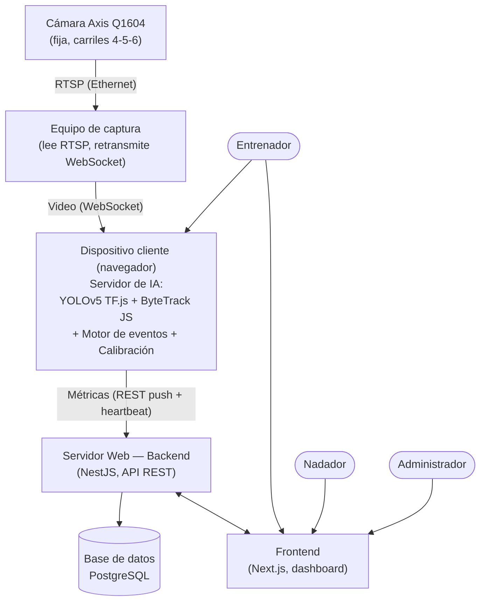
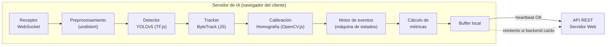
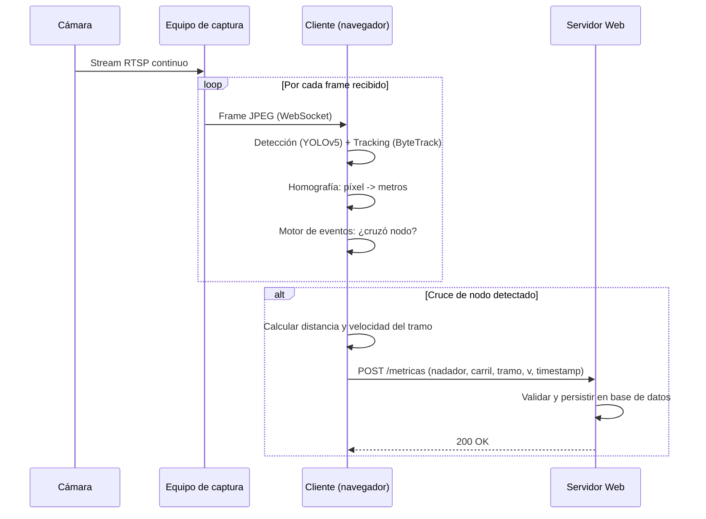
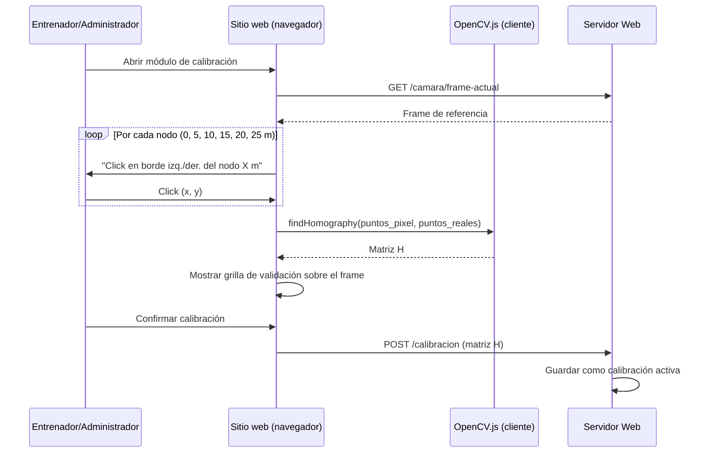
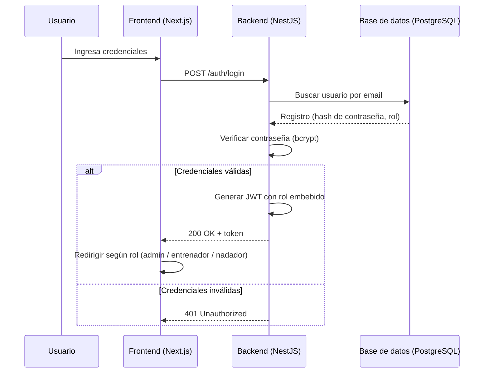
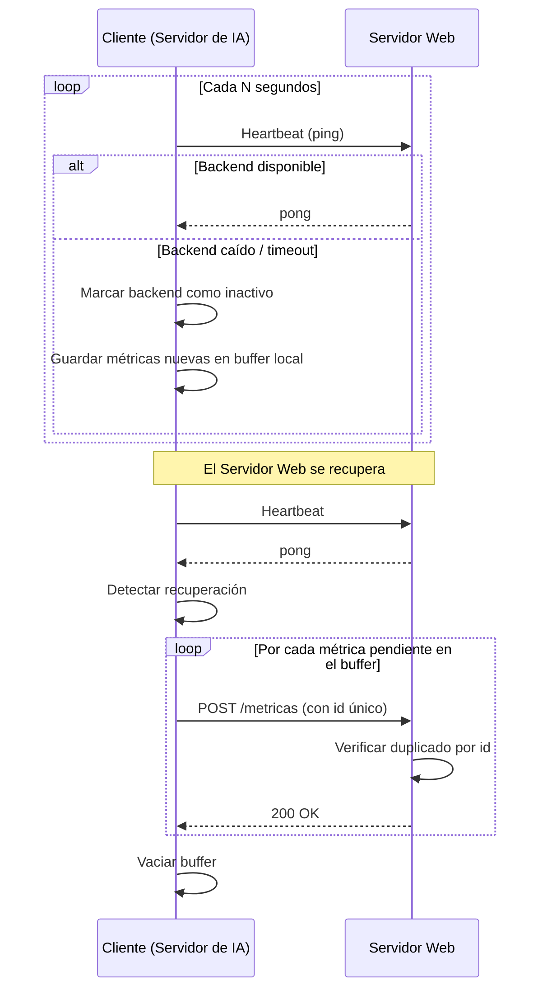
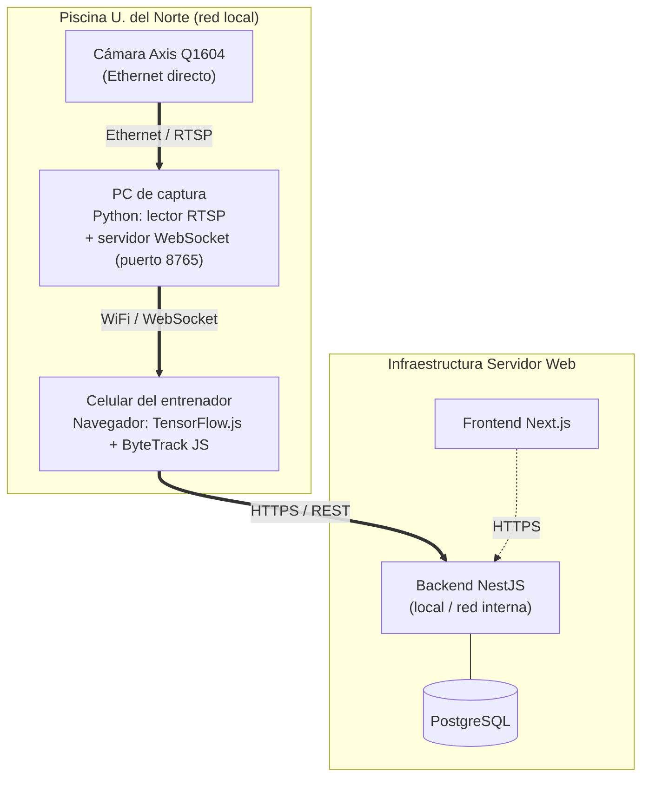
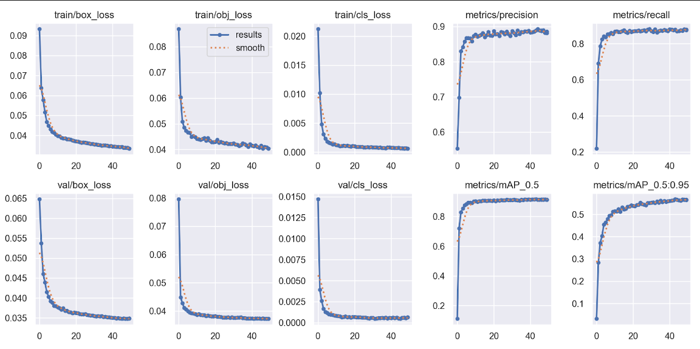

# Segundo Informe — Safe Splash 2: sistema de monitoreo del rendimiento de nadadores mediante visión por computador

## Resumen / Abstract

El seguimiento del rendimiento en natación depende hoy, en gran medida, de la observación y el cronometraje manual por parte del entrenador, lo que introduce imprecisiones y limita la posibilidad de construir un historial digital y objetivo del desempeño del deportista. Safe Splash 2 propone un sistema de visión por computador que, mediante una única cámara fija instalada sobre los carriles 4, 5 y 6 de la piscina semiolímpica de la Universidad del Norte, detecta y sigue automáticamente a los nadadores, identifica eventos de nado (inicio y fin de vuelta, cambios de dirección, períodos de descanso) y calcula métricas de desempeño: tiempo por vuelta, distancia recorrida, velocidad promedio y ritmo, sin necesidad de instrumentar al deportista con sensores portátiles. La solución se apoya en un modelo YOLOv5 con tracking integrado (ByteTrack), calibrado contra las medidas físicas predefinidas de la piscina mediante homografía, y se organiza en una arquitectura de dos servidores: un **Servidor de IA** encargado del procesamiento de video y del cálculo de métricas, y un **Servidor Web** encargado del almacenamiento, la autenticación y la visualización, sincronizados entre sí mediante un mecanismo de heartbeat con buffer.

En este período se logró completar el ajuste fino del modelo detector YOLOv5s sobre un dataset propio de nadadores y confirmar su desempeño frente a un conjunto de prueba que nunca participó del entrenamiento. Sobre ese conjunto independiente (750 imágenes) el detector obtuvo una precisión de 0.879, un recall de 0.879, un mAP50 de 0.911 y un mAP50-95 de 0.563; valores muy cercanos a los que ya se habían observado durante la validación en entrenamiento, lo que da tranquilidad de que el modelo aprendió patrones generalizables y no simplemente memorizó las imágenes con las que se entrenó. También se integró el módulo de seguimiento multiobjeto ByteTrack sobre las detecciones del modelo, y se evaluaron dos caminos posibles para dónde correr la inferencia una vez el sistema esté en producción: directamente en el celular del entrenador mediante TensorFlow.js, o en un servidor remoto con GPU. Para el primero de esos caminos ya se construyó y probó una transmisión de video en tiempo casi real desde la cámara hacia el navegador por WebSocket. Queda por delante: llevar el tracker y el motor de eventos al entorno de producción (el navegador), calibrar la cámara en campo, construir el Servidor Web (backend, frontend, autenticación, reportes) y hacer las pruebas de campo comparando contra cronometraje manual.

---

## 1. Introducción

El entrenamiento deportivo de alto rendimiento se apoya cada vez más en tecnologías capaces de capturar información cuantitativa objetiva sobre el desempeño de los atletas, y la natación no es la excepción. En los últimos años, la visión por computador y el aprendizaje profundo han pasado de ser técnicas experimentales a convertirse en herramientas viables para el análisis deportivo: modelos de detección de objetos como la familia YOLO, combinados con algoritmos de seguimiento multiobjeto como ByteTrack o DeepSORT, permiten hoy detectar, seguir e interpretar el movimiento de personas dentro de un video sin necesidad de instrumentación física. En el ámbito de la natación en particular, el software cumple un rol cada vez más central como intermediario entre el gesto del deportista en el agua y la información que el entrenador necesita para tomar decisiones, sustituyendo progresivamente tareas que tradicionalmente exigían observación directa y registro manual.

A pesar de este avance tecnológico, la situación actual en la mayoría de los entornos de entrenamiento —incluida la piscina semiolímpica de la Universidad del Norte— sigue dependiendo casi por completo de la observación y el cronometraje manual. Esto obliga al entrenador a repartir su atención entre dirigir la sesión, cronometrar a los nadadores y registrar la información relevante, lo cual introduce errores humanos en el inicio y la parada del cronómetro y hace prácticamente inviable cronometrar con precisión a varios nadadores de forma simultánea. Además, la ausencia de un registro digital estructurado impide construir un historial de rendimiento que permita comparar sesiones, identificar tendencias y evaluar objetivamente la progresión del deportista a lo largo del tiempo, una carencia que afecta tanto a entrenadores, que pierden capacidad de análisis longitudinal, como a los propios nadadores, que no cuentan con retroalimentación cuantitativa sistemática de su evolución.

De esta situación se desprende una necesidad técnica concreta: contar con un mecanismo automático, no invasivo y de bajo costo de instrumentación, capaz de observar a los nadadores durante el entrenamiento y traducir ese video en métricas objetivas de desempeño. La oportunidad de diseño tecnológico consiste en aprovechar los avances recientes en detección y seguimiento de objetos —ya demostrados en otros contextos de natación con configuraciones de mayor infraestructura, como sistemas de ocho cámaras o de captura aérea mediante drones— para plantear una solución equivalente pero adaptada a una restricción real y frecuente en entornos universitarios: la disponibilidad de una única cámara fija que solo cubre una zona parcial de la piscina.

Sobre esta base surge Safe Splash 2, un sistema de visión por computador orientado al seguimiento automático de nadadores en la piscina semiolímpica de la Universidad del Norte mediante una cámara fija instalada sobre los carriles 4, 5 y 6. Sus funcionalidades clave incluyen la detección y el seguimiento del nadador mediante un modelo YOLO con tracking integrado, la identificación automática de eventos de nado y el cálculo de métricas como tiempo por vuelta, distancia recorrida, velocidad promedio y ritmo, todo ello accesible mediante una plataforma web con autenticación para entrenadores y nadadores. El impacto esperado es ofrecer una herramienta objetiva, escalable y de bajo costo de instrumentación que complemente —y no reemplace— el criterio del entrenador, sirviendo de base para las secciones siguientes, en las que se detalla el problema, el alcance, los objetivos y la solución propuesta, así como el avance técnico alcanzado hasta el momento.

---

## 2. Marco conceptual

### 2.1. Visión por computador
La visión por computador es el conjunto de técnicas utilizadas para obtener información de interés a partir de imágenes y videos. En el contexto de Safe Splash 2, constituye el componente encargado de transformar las imágenes capturadas por la cámara en información sobre la presencia, posición y desplazamiento de los nadadores.

La visión por computador resulta especialmente relevante en este proyecto porque permite realizar mediciones sin necesidad de instalar sensores directamente sobre el cuerpo del deportista.

En investigaciones recientes de natación se han utilizado cámaras para detectar y analizar automáticamente el movimiento de los nadadores. Chern et al. (2025), por ejemplo, desarrollaron un sistema de análisis basado en video y aprendizaje automático para obtener información cuantitativa del desempeño.

### 2.2. Procesamiento de imágenes y video
El procesamiento de imágenes comprende las operaciones realizadas sobre los cuadros obtenidos por una cámara antes de ejecutar las etapas de detección y seguimiento.

En una piscina, esta etapa puede ser importante debido a que los reflejos, las ondas, las salpicaduras y otros elementos visuales pueden generar información que dificulte la detección del nadador.

Por ello, Safe Splash 2 contempla la posibilidad de aplicar operaciones de reducción de ruido, filtrado, corrección de distorsión de lente y segmentación antes de ejecutar el detector. El informe original identifica específicamente el ruido visual producido por el agua como una de las restricciones técnicas del proyecto.

### 2.3. Detección de objetos
La detección de objetos consiste en localizar objetos dentro de una imagen y determinar su posición mediante regiones delimitadoras, normalmente conocidas como bounding boxes.

En Safe Splash 2, el objeto de interés es el nadador (y, como clase auxiliar, la persona fuera del agua). El detector identifica su posición en cada cuadro del video para posteriormente proporcionar esta información al módulo de seguimiento.

Los modelos de la familia YOLO son especialmente relevantes para este problema porque fueron diseñados para realizar detección de objetos de manera eficiente. Además, investigaciones específicas sobre natación han utilizado YOLO adaptado al dominio para detectar nadadores. Chern et al. (2025) utilizaron YOLOv4 como modelo inicial y realizaron transferencia de aprendizaje utilizando más de 120.000 imágenes etiquetadas de nadadores.

### 2.4. YOLO y aprendizaje por transferencia
YOLO (You Only Look Once) corresponde a una familia de modelos de detección de objetos que realizan la localización y clasificación de objetos directamente a partir de la imagen, en una sola pasada por la red (a diferencia de arquitecturas de dos etapas como Faster R-CNN).

Una dificultad importante del proyecto consiste en que los nadadores presentan una apariencia diferente a las personas en escenarios terrestres: el cuerpo está parcialmente sumergido, deformado por la refracción del agua, y rodeado de espuma y salpicaduras que generan ruido visual.

Por esta razón, Safe Splash 2 utiliza aprendizaje por transferencia (*transfer learning*/*fine-tuning*), partiendo de un modelo YOLOv5 ya entrenado específicamente para detección de nadadores —los pesos públicos del repositorio [DBDoco/yolo-swimmer-detection](https://github.com/DBDoco/yolo-swimmer-detection)— y ajustándolo (*fine-tuning*) mediante datos propios capturados en la piscina de la Universidad del Norte, bajo el ángulo, la altura e iluminación reales de la instalación. Este procedimiento es análogo al utilizado por Chern et al. (2025), quienes adaptaron YOLOv4 mediante transferencia de aprendizaje para desarrollar un detector específico para nadadores; en la sección 11 se detalla en profundidad el procedimiento, las librerías y los resultados concretos obtenidos.

### 2.5. Seguimiento de objetos
La detección permite localizar un nadador en un cuadro determinado; el seguimiento de objetos busca mantener la correspondencia entre las detecciones de diferentes cuadros, asignando una identidad (ID) persistente a cada nadador.

Esto permite construir una trayectoria temporal del objeto.

En Safe Splash 2, el seguimiento es necesario porque las métricas no dependen únicamente de saber dónde está el nadador en un instante, sino de conocer cómo cambia su posición a través del tiempo, y de poder distinguir a un nadador de otro cuando hay varios en el campo observado.

### 2.6. Seguimiento multiobjeto
El Multiple Object Tracking (MOT) consiste en localizar diferentes objetos y mantener una identidad asociada a cada uno a lo largo de una secuencia de video.

Este concepto resulta relevante porque Safe Splash 2 debe contemplar la posibilidad de que existan varios nadadores dentro de la zona observada (hasta 3, uno por carril, según el alcance del MVP).

El seguimiento multiobjeto presenta problemas como pérdida de identidad, fragmentación de trayectorias y oclusiones. ByteTrack fue desarrollado precisamente para mejorar la asociación entre detecciones y trayectorias, utilizando también detecciones de menor confianza para recuperar objetos que podrían perderse durante el seguimiento.

### 2.7. ByteTrack
ByteTrack es un algoritmo de seguimiento multiobjeto propuesto por Zhang et al. (2022).

Su principal característica es que no descarta automáticamente todas las detecciones que presentan una confianza baja. En lugar de ello, intenta asociarlas con trayectorias existentes para recuperar objetos que pueden encontrarse parcialmente ocultos (por ejemplo, un nadador parcialmente sumergido o tapado por salpicaduras).

Los autores reportaron resultados de 80,3 MOTA y 77,3 IDF1 en MOT17, con una velocidad de aproximadamente 30 FPS utilizando una GPU V100 en el experimento presentado en su trabajo.

Estos valores corresponden a benchmarks generales de seguimiento sobre personas en entornos terrestres, y no deben interpretarse como resultados esperados para Safe Splash 2. El proyecto ya integró ByteTrack sobre las detecciones del modelo propio (mediante la librería `boxmot`) y deberá todavía evaluar experimentalmente, con las métricas MOTA e IDF1, su comportamiento específico en el entorno acuático, una vez se disponga de video anotado de referencia.

### 2.8. Trayectoria
La trayectoria representa la evolución de la posición de un nadador a través del tiempo.

Si el detector proporciona las coordenadas del centro de la región delimitadora y el tracker mantiene la identidad del nadador, es posible construir una secuencia:

posición₁ → posición₂ → posición₃ → ... → posiciónₙ

Esta trayectoria constituye la información fundamental para posteriormente detectar desplazamientos, cruces de líneas y cambios de dirección.

### 2.9. Detección de eventos
Un evento corresponde a una situación identificable dentro de la trayectoria del nadador.

En Safe Splash 2, algunos eventos pueden definirse mediante líneas o zonas virtuales dentro de la imagen. Por ejemplo:

entrada a la zona observable;
salida de la zona observable;
cruce de una línea virtual (nodo de color);
cambio de dirección inferido (viraje);
inicio de un intervalo de reposo;
finalización de un intervalo de reposo.

Debido a que la cámara no observa directamente los extremos de la piscina, el sistema debe diferenciar entre eventos observados directamente y eventos inferidos. Esta distinción es fundamental para evitar atribuir al sistema capacidades que la cámara no posee. El motor de eventos se modela como una máquina de estados con dos estados principales —**NADANDO** y **DESCANSANDO**— cuya transición se determina a partir de la velocidad instantánea calculada sobre la trayectoria homografiada del nadador, sostenida durante una ventana de tiempo mínima que evita falsos cambios de estado producidos por ruido del tracker o del propio oleaje.

### 2.10. Calibración de cámara
La calibración permite establecer la relación entre las coordenadas de la imagen y el espacio físico.

Una imagen representa posiciones en píxeles, mientras que las métricas deportivas requieren unidades físicas como metros y segundos.

La literatura sobre seguimiento de nadadores ha utilizado técnicas de transformación geométrica para calibrar videos y obtener información espacial. Un sistema de seguimiento de nadadores basado en un enfoque de objetivos relacionados utilizó transformación lineal directa para calibrar los videos y posteriormente estimar el movimiento y la velocidad. En Safe Splash 2, la calibración se realiza en dos etapas: primero una corrección de la distorsión propia de la lente de la cámara (parámetros intrínsecos, obtenidos mediante un patrón de calibración tipo tablero de ajedrez), y después el cálculo de la homografía propiamente dicha (sección 2.11).

### 2.11. Homografía
La homografía es una transformación proyectiva que permite establecer correspondencias entre dos planos.

En el proyecto se utiliza para transformar puntos identificados en la imagen (en píxeles) hacia un sistema de coordenadas asociado al plano de la piscina (en metros reales). Esta transformación es especialmente útil porque se conocen puntos de referencia fijos del entorno: los nodos de color ubicados cada 5 metros en los divisores de carril, cuya distancia real al borde de salida es conocida de antemano (0, 5, 10, 15, 20 y 25 metros).

La homografía se calcula una única vez por posición de cámara, marcando manualmente (mediante una interfaz guiada en el sitio web) las coordenadas en píxeles de cada nodo visible, y resolviendo la matriz de transformación mediante el método de los mínimos cuadrados con descarte de valores atípicos (RANSAC). Dado que la cámara puede reubicarse entre sesiones (a diferencia del supuesto original de cámara permanentemente fija), este proceso de calibración debe poder repetirse de forma rápida y accesible para personal no técnico; esta decisión de diseño se detalla en la sección 10. La calibración debe validarse experimentalmente, debido a que errores en la correspondencia entre píxeles y posiciones físicas se trasladan directamente a las métricas de distancia y velocidad.

### 2.12. Distancia, velocidad y ritmo
Una vez obtenida una estimación de la posición del nadador en coordenadas físicas, es posible calcular diferentes métricas.

La distancia recorrida corresponde a la longitud del desplazamiento estimado, medida en múltiplos de 5 metros (la distancia entre nodos consecutivos).

La velocidad promedio por tramo se calcula como:

v = d / Δt

donde:

v representa la velocidad promedio del tramo;
d representa la distancia recorrida (5 metros, fija);
Δt representa el intervalo de tiempo entre el cruce del nodo anterior y el cruce del nodo actual.

El ritmo puede expresarse como el tiempo requerido para recorrer una distancia determinada, por ejemplo minutos por cada 100 metros.

Sin embargo, debido a la cobertura parcial de Safe Splash 2, estas métricas se definen de acuerdo con la zona realmente observada (los tres carriles cubiertos de extremo a extremo) y no asumen que la cámara observa la totalidad de una piscina de 25 metros en todos sus carriles.

### 2.13. Tiempo de descanso
El tiempo de descanso se estima identificando períodos durante los cuales la trayectoria del nadador permanece prácticamente estacionaria (velocidad por debajo de un umbral mínimo) durante un intervalo de tiempo sostenido.

Esta métrica requiere un umbral de movimiento calibrado experimentalmente, para distinguir entre una pausa real y pequeñas variaciones de posición producidas por el movimiento del agua o por fluctuaciones del detector/tracker. El diseño adoptado (sección 2.9) exige que la velocidad se mantenga por debajo del umbral durante una ventana de confirmación de varios segundos antes de declarar el inicio del descanso, precisamente para absorber ese ruido.

### 2.14. Tiempo cercano al real
El término near real-time hace referencia a un sistema que procesa los datos con una latencia suficientemente baja para proporcionar información durante o inmediatamente después de la captura.

El informe propone explícitamente un procesamiento cercano al tiempo real, sin exigir que el sistema cumpla necesariamente una condición estricta de tiempo real.

Esta definición resulta apropiada porque permite evaluar experimentalmente la latencia sin establecer previamente un valor que todavía no ha sido medido en campo, aunque sí se dispone de mediciones preliminares de latencia de transmisión obtenidas en las pruebas de concepto de streaming (sección 11.2).

---

## 3. Planteamiento del problema

### 3.1 Descripción del problema

En la piscina semiolímpica de la Universidad del Norte —al igual que en la mayoría de los entornos de entrenamiento de natación que no cuentan con infraestructura de análisis automatizado— el seguimiento del rendimiento de los nadadores depende casi exclusivamente de la observación directa y el cronometraje manual realizado por el entrenador. Esta situación no es un caso aislado, sino una carencia transferible a cualquier contexto de entrenamiento con recursos tecnológicos limitados: existen técnicas de visión por computador capaces de automatizar este análisis, pero no están siendo aprovechadas en la práctica cotidiana del entrenamiento.

Esta carencia se manifiesta de varias formas. En primer lugar, la carga cognitiva del entrenador se ve comprometida cuando debe simultáneamente dirigir la sesión, cronometrar y registrar datos, lo que le resta capacidad de atención a los aspectos cualitativos del entrenamiento. En segundo lugar, la precisión del cronometraje manual es limitada: los errores humanos en el inicio y la parada del cronómetro, sumados a la dificultad de cronometrar a múltiples nadadores de forma simultánea, introducen imprecisiones que pueden oscurecer la verdadera evolución del deportista. En tercer lugar, la falta de un registro digital estructurado impide construir un historial de rendimiento que permita comparar sesiones, identificar tendencias y evaluar objetivamente la progresión del nadador a lo largo del tiempo.

Las principales afectadas por esta carencia son dos poblaciones concretas: los entrenadores, que carecen de una herramienta objetiva y escalable para el análisis diario y la evaluación técnica, y los propios nadadores, que no reciben retroalimentación cuantitativa sistemática sobre su desempeño. La consecuencia directa es que las decisiones de entrenamiento —ajustes de ritmo, series, tiempos de descanso— terminan apoyándose en percepciones subjetivas en lugar de datos verificables, lo que limita la calidad del proceso de mejora deportiva.

### 3.2 Restricciones y supuestos de diseño

El planteamiento de la solución asume las siguientes restricciones y supuestos:

- **Cámara única (Axis Q1604), conexión por Ethernet directa y campo visual parcial:** el sistema dispone de una sola cámara fija instalada sobre los carriles 4, 5 y 6, conectada por cable Ethernet directamente al equipo de captura (sin router/switch intermedio); no cubre el resto de los carriles.
- **Disponibilidad de la piscina y de usuarios de prueba:** el desarrollo y la validación dependen de la disponibilidad de horarios de acceso a la piscina semiolímpica y de la colaboración voluntaria de nadadores y entrenadores para las pruebas de campo.
- **Recursos computacionales acotados:** el proyecto se desarrolla con los recursos de cómputo disponibles en un contexto académico, sin garantía de acceso permanente a hardware GPU de alto rendimiento, lo cual condicionó las decisiones sobre el tamaño y la complejidad del modelo a emplear y, como se detalla en la sección 9.4, la ubicación de la inferencia.
- **Condiciones ambientales variables no controladas en su totalidad:** aunque se busca mitigar el efecto de reflejos, salpicaduras e iluminación variable mediante preprocesamiento, no se garantiza un desempeño óptimo bajo condiciones ambientales extremas.
- **Tiempo de desarrollo acotado al calendario académico:** el alcance del prototipo y el plan de trabajo están condicionados por la duración del período académico en el que se desarrolla el proyecto.

Las restricciones identificadas en el Primer Informe se mantienen, con los siguientes ajustes derivados de la retroalimentación recibida y del trabajo de campo realizado en este período:

- **Cobertura de cámara ampliada:** el montaje se elevó a 2.5 metros de altura (misma cámara), lo que amplió la cobertura de dos a **tres carriles** observables con claridad, en lugar de los dos carriles previstos originalmente.
- **Calibración basada en nodos de color:** la calibración ya no depende únicamente de medidas físicas generales de la piscina, sino específicamente de los cambios de color de los divisores de carril cada 5 metros, que actúan como puntos de referencia fijos para la homografía.
- **Ejecución de la inferencia reconsiderada (edge/cliente vs. nube):** inicialmente se planteaba ejecutar YOLOv5 localmente en un equipo dedicado. Tras evaluar la restricción de recursos computacionales (la PC de desarrollo no cuenta con GPU dedicada) y la necesidad de que el sistema sea operable por el entrenador sin depender de hardware adicional, el equipo decidió priorizar la ejecución de la inferencia **en el navegador del dispositivo cliente (celular del entrenador), mediante TensorFlow.js**, mientras la cámara transmite video en tiempo casi real por WebSocket desde el equipo de captura. Esta decisión, su justificación completa y la alternativa de respaldo (servidor en la nube) se documentan en la sección 9.4.
- **Procesamiento no continuo:** para reducir la carga sobre el modelo, la toma de datos no es completamente en tiempo real; el sistema se apoya en los nodos de referencia cada 5 metros en lugar de un registro constante cuadro a cuadro, y tolera una latencia de inferencia variable (ver discusión de FPS vs. resolución en la sección 11.2).

### 3.3 Alcance actualizado

- **Carriles declarados:** el sistema procesa los tres carriles que quedan cubiertos con claridad tras la elevación de la cámara a 2.5 metros de altura (antes solo dos), sin cobertura de los carriles restantes de la piscina ni de sus extremos.
- **Nadadores simultáneos:** el MVP se compromete a detectar y seguir de forma confiable hasta 3 nadadores simultáneos, uno por carril observado, dado que cada carril se procesa de forma independiente. Este número es un punto de partida de trabajo que el equipo ajustará según las pruebas reales de detección con múltiples nadadores.
- **Eventos comprometidos:** el evento central y directamente observable del MVP es el paso del nadador por cada nodo de color de los divisores de carril, ubicados cada 5 metros; dado que la cámara cubre los tres carriles observados de extremo a extremo, el viraje contra la pared también es un evento directamente observable dentro de esos tres carriles, y por tanto forma parte de las métricas garantizadas del MVP para los nadadores que permanecen en un carril cubierto. El inicio y fin de los períodos de descanso también se consideran observables de forma directa, mediante la máquina de estados descrita en la sección 2.9.
- **Métricas comprometidas para el MVP:** a partir de los eventos de paso por nodo, el sistema calculará distancia recorrida (en múltiplos de 5 metros), velocidad promedio por tramo y por sesión, tiempo por vuelta y conteo de largos completos para los nadadores que permanecen en un carril cubierto, así como el tiempo de descanso acumulado por sesión; se excluyen explícitamente del MVP las métricas fuera del rango cubierto por los tres carriles.

---

## 4. Objetivos

### 4.1 Objetivo general

Diseñar e implementar un sistema inteligente basado en visión por computador que permita realizar el seguimiento automático de nadadores durante sus sesiones de entrenamiento en la piscina semiolímpica de la Universidad del Norte, mediante una única cámara calibrada contra las medidas físicas predefinidas de la piscina, registrando tiempos, recorridos e indicadores de desempeño que apoyen el análisis objetivo del entrenamiento por parte de entrenadores y deportistas.

### 4.2 Objetivos específicos

1. Capturar y calibrar el video de entrenamiento mediante una cámara fija, estableciendo la correspondencia entre coordenadas de imagen y distancias reales a partir de las medidas estáticas predefinidas de la piscina (longitud de carril y nodos de color).
2. Preprocesar y estandarizar los frames capturados (redimensionamiento, corrección de distorsión de lente, corrección de iluminación, mejora de contraste, reducción de ruido, corrección de perspectiva y normalización), garantizando que únicamente frames estandarizados y validados sean enviados al modelo de inteligencia artificial.
3. Detectar y realizar seguimiento (tracking) automático de máximo tres nadadores presentes en los carriles 4, 5 y 6 mediante un modelo YOLOv5 ajustado por transferencia de aprendizaje, combinado con ByteTrack, manteniendo la identidad de cada nadador durante toda la sesión, incluso ante oclusiones temporales o cambios de dirección. **(Avance: el ajuste del detector se completó y validó durante este período; ver sección 11 y 13).**
4. Identificar automáticamente eventos de nado, tales como el inicio y fin de cada vuelta, cambios de dirección, períodos de descanso y finalización del entrenamiento.
5. Calcular métricas de desempeño por nadador —tiempo por vuelta, tiempo total, distancia recorrida, velocidad promedio, ritmo de entrenamiento, número de largos y tiempos de descanso— a partir de los datos generados por el módulo de tracking.
6. Diseñar una arquitectura de comunicación entre el Servidor de IA y el Servidor Web que permita el envío confiable de métricas, la validación de la información recibida y la sincronización del estado de ambos servicios (activo/inactivo, heartbeat).
7. Desarrollar una plataforma web (backend + frontend) que permita a entrenadores y nadadores visualizar estadísticas en tiempo real, consultar el historial de entrenamientos y comparar sesiones anteriores.
8. Generar reportes de desempeño exportables en formato PDF y CSV, que resuman las métricas individuales y la evolución del rendimiento del nadador.
9. Gestionar los roles de usuario (administrador, entrenador, nadador) mediante un módulo de autenticación y autorización que restrinja el acceso a las funciones según el perfil correspondiente.

---

## 5. Estado del arte / soluciones relacionadas

La literatura especializada muestra una evolución desde sistemas basados exclusivamente en sensores portátiles hacia soluciones capaces de utilizar video para realizar mediciones sin instrumentar físicamente al nadador. A continuación se presentan cinco antecedentes representativos, evaluados frente a los criterios de funcionalidad, escalabilidad, costo/infraestructura, usabilidad y limitaciones técnicas, seguidos de los vacíos identificados que justifican la propuesta de Safe Splash 2.

**Chern et al. (2025) — Sistema de análisis de estilo mariposa.** Desarrollaron un sistema inteligente para registrar y analizar el estilo mariposa mediante ocho cámaras (cuatro sobre el agua y cuatro bajo el agua) distribuidas a lo largo de una piscina de 25 metros, junto con acelerómetros. El modelo de reconocimiento fue entrenado mediante transfer learning sobre 120.031 imágenes etiquetadas, utilizando YOLOv4 como base, y alcanzó un IoU de 81,51 % y un error absoluto medio de 0,36 segundos en tiempos parciales. Es un antecedente clave por demostrar la viabilidad de YOLO en el dominio acuático, pero su infraestructura (ocho cámaras + sensores portátiles) es considerablemente mayor que la de Safe Splash 2, lo que limita su escalabilidad a contextos con recursos reducidos.

**Dronaquatics (Tran et al., 2026) — Análisis de natación con drones.** Sistema completamente basado en visión que utiliza imágenes aéreas capturadas por drones para eliminar la necesidad de dispositivos portátiles o equipos subacuáticos. Reportó un error de estimación de velocidad inferior al 4 % (menos de 0,05 m/s) y un error en tiempo por vuelta de 0,03 segundos. Ofrece alta funcionalidad y buena usabilidad de operación (un solo operador de dron), pero su escalabilidad está condicionada por la necesidad de personal capacitado para el vuelo del dron y por restricciones normativas de uso de drones en instalaciones cerradas, además de un costo de hardware mayor al de una cámara fija.

**SwimmerNET (Giulietti et al., 2023) — Estimación de pose subacuática.** Método sin marcadores para estimación de pose 2D bajo el agua mediante una única cámara gran angular de 8 Megapíxeles y redes neuronales completamente convolucionales, probado en los estilos libre, mariposa y espalda con un error promedio de ~1 mm y una desviación estándar de ~10 mm en el peor escenario. Es el antecedente más cercano a Safe Splash 2 en términos de infraestructura (cámara única), lo que respalda la viabilidad técnica de esta configuración; sin embargo, su enfoque está orientado a la estimación de pose biomecánica y no a métricas de desplazamiento agregadas por sesión, ni incorpora una plataforma web de consulta.

**SMU y SUTD (2025) — Análisis con drones para nadadores de élite.** Sistema desplegado en marzo de 2025 por investigadores de Singapore Management University y Singapore University of Technology and Design para el equipo nacional de natación de Singapur, que analiza en tiempo real duración de la brazada, velocidad de nado y simetría corporal segmentando el cuerpo del atleta en 17 puntos. Tiene alta funcionalidad y validación en contexto de alto rendimiento, pero de nuevo depende de un dron operado por personal especializado, lo que eleva su costo y limita su replicabilidad en entornos universitarios con recursos acotados.

**Proyectos de código abierto en GitHub.** YOLO-swimmer-detection (DBDoco) implementa detección de nadadores en Python con YOLO, un frontend HTTP simple y un servidor Flask; es, de hecho, el modelo base del cual parte el fine-tuning de Safe Splash 2 (sección 11). SwimmingStyleAnalysis (Sapna24Sangmitra, 2024) implementa un pipeline más completo basado en YOLOv8 que combina extracción de cuadros, detección, estimación de pose (YOLOv8-pose) y clasificación de estilo de nado, con suavizado temporal. Ambos son gratuitos y de bajo costo de infraestructura, lo que los hace altamente escalables, pero carecen de módulos de calibración física de la piscina, de cálculo de métricas de entrenamiento (tiempo por vuelta, distancia, ritmo) y de una plataforma web orientada a entrenadores y nadadores, quedándose en el nivel de prueba de concepto técnico.

| Sistema | Funcionalidad | Escalabilidad | Costo / infraestructura | Usabilidad | Limitaciones técnicas |
|---|---|---|---|---|---|
| Chern et al. (2025) | Tiempos parciales, conteo de brazadas, ángulos de rodilla | Baja (8 cámaras + acelerómetros) | Alto | Requiere instalación fija compleja | No aplicado fuera del estilo mariposa validado |
| Dronaquatics (2026) | Velocidad, tiempo por vuelta, conteo de brazadas | Media (requiere operador de dron) | Medio-alto | Buena una vez en vuelo | Restricciones normativas y de espacio para volar en piscinas cubiertas |
| SwimmerNET (2023) | Pose 2D detallada del nadador | Alta (cámara única) | Bajo | Orientado a análisis técnico especializado | No calcula métricas agregadas de sesión ni tiene interfaz web |
| SMU/SUTD (2025) | Brazada, velocidad, simetría corporal en tiempo real | Media (requiere dron y personal) | Alto | Alta en contexto de selección nacional | Difícil de replicar con recursos universitarios limitados |
| Proyectos open-source (DBDoco; Sapna24Sangmitra, 2024) | Detección de nadadores; detección + pose + clasificación de estilo | Alta (gratuitos, cámara única) | Muy bajo | Nivel de prototipo técnico, sin UI orientada a usuario final | Sin calibración física, sin métricas de entrenamiento ni plataforma web |

**Resultados esperados de la revisión.** La revisión evidencia que existen soluciones consolidadas para partes aisladas del problema —detección de nadadores, seguimiento de objetos (ByteTrack, DeepSORT), estimación de pose y cálculo de métricas de desplazamiento—, pero ninguna de ellas combina, con una única cámara fija de bajo costo, la calibración física de la piscina, el cálculo de métricas de entrenamiento orientadas al entrenador (tiempo por vuelta, distancia, ritmo, descansos) y una plataforma web con roles diferenciados para consulta histórica. Los sistemas con mayor precisión reportada (Chern et al., 2025; Dronaquatics, 2026; SMU/SUTD, 2025) dependen de infraestructuras de captura amplias (múltiples cámaras o drones) inviables en un entorno universitario típico, mientras que las soluciones de cámara única (SwimmerNET, 2023; proyectos open-source) no cubren el cálculo de métricas de entrenamiento ni la capa de aplicación web. Esta combinación de restricciones —cámara única, bajo costo y orientación a entrenamiento— constituye el vacío técnico que Safe Splash 2 busca atender, y su aporte no debe plantearse como la creación de un nuevo algoritmo de detección o tracking, sino como la integración y adaptación de técnicas existentes a un escenario específico con restricciones reales de hardware, campo visual y procesamiento.

---

## 6. Solución propuesta

Safe Splash 2 propone construir un sistema compuesto por una cámara fija, un **Servidor de IA** y un **Servidor Web** que trabajan de forma coordinada para transformar video en información útil de entrenamiento. A alto nivel, el flujo de procesamiento sigue la secuencia: *Cámara → Transmisión de video → Preprocesamiento → Detector de nadadores (YOLOv5) → Tracker (ByteTrack) → Motor de eventos → Calibración/transformación espacial (homografía) → Cálculo de métricas → Envío al Servidor Web → Base de datos → API/Backend → Dashboard web*.

El **Servidor de IA**, como se detalla en la sección 9.4, se materializa en esta versión del proyecto como un cliente web (navegador del dispositivo del entrenador) que recibe el video transmitido desde el equipo conectado a la cámara, y concentra ahí el procesamiento: estandariza cada cuadro (redimensionamiento, corrección de distorsión de lente, corrección de perspectiva), detecta y sigue al nadador mediante YOLOv5 (exportado a TensorFlow.js) con ByteTrack, identifica eventos de nado a partir de la trayectoria homografiada (cruces de nodo, cambios de dirección, inicio/fin de descanso) y calcula las métricas de desempeño por tramo. El **Servidor Web**, por su parte, recibe estas métricas ya calculadas, las almacena en una base de datos, gestiona la autenticación y los roles de usuario, y expone la información mediante una plataforma con frontend accesible a entrenadores y nadadores. Ambos componentes se comunican mediante una arquitectura con sincronización de estado (heartbeat) y buffer local, lo que permite detectar caídas de servicio y mantener la confiabilidad del envío de métricas.

Los usuarios del sistema son tres: **nadadores**, que consultan su historial y evolución de desempeño; **entrenadores**, que además pueden hacer seguimiento a los nadadores a su cargo y generar reportes exportables; y **administradores**, encargados de la gestión general de usuarios y roles. Esta solución constituye una respuesta adecuada al problema planteado porque automatiza precisamente las tareas que hoy recaen por completo en el entrenador —cronometraje, registro y cálculo de métricas—, sin requerir instrumentación física del nadador ni una infraestructura de cámaras múltiples ni servidores dedicados permanentes, ajustándose así a una restricción real y común en entornos universitarios: la disponibilidad de una sola cámara fija con cobertura parcial de la piscina y de recursos computacionales acotados.

---

## 7. Metodología de desarrollo

El desarrollo de Safe Splash 2 sigue un enfoque de **prototipado iterativo**, en el cual la solución se construye mediante ciclos sucesivos de diseño, construcción, prueba y ajuste, en lugar de intentar entregar el sistema completo en una sola etapa. Esta elección responde a la naturaleza incierta de varios componentes del proyecto —en particular, la precisión alcanzable del detector y del tracker en condiciones reales de la piscina de la Universidad del Norte, que no podía conocerse con certeza antes de experimentar— por lo que resultó más apropiado avanzar validando supuestos técnicos en cada ciclo (calidad de detección, estabilidad del tracking, viabilidad de la calibración, viabilidad del streaming en tiempo casi real) antes de comprometer decisiones de arquitectura definitivas para las etapas siguientes. Este enfoque ya permitió, durante el presente período, revisar y ajustar la decisión inicial sobre dónde ejecutar la inferencia del modelo (sección 9.4), a partir de la restricción de hardware real con la que cuenta el equipo.

### 7.2 Iteraciones o fases de desarrollo

- **Fase 0 — Investigación y preparación (completada):** definición de requerimientos, medición y documentación física de la piscina (longitud de carril, marcas de fondo, banderas de vuelta), y revisión del estado del arte para fijar la línea base técnica.
- **Fase 1 — Prototipo de detección (completada):** construcción de un conjunto de datos propio de imágenes de nadadores en la piscina de la universidad, y ajuste (fine-tuning) de un modelo YOLOv5 para la detección del nadador dentro de la zona observable. El procedimiento completo, las librerías utilizadas y los resultados cuantitativos se documentan en la sección 11 y en el anexo técnico de entrenamiento.
- **Fase 2 — Integración de tracking y motor de eventos (en curso):** incorporación del algoritmo de seguimiento multiobjeto ByteTrack sobre las detecciones del modelo (ya integrado y validado en entorno de prueba Python); pendiente el diseño detallado del motor de eventos basado en líneas o zonas virtuales y su portado al entorno de producción (navegador).
- **Fase 3 — Calibración y cálculo de métricas (en curso):** diseño conceptual completado (homografía por nodos de color, corrección de distorsión de lente); pendiente la implementación de la herramienta de recalibración en el sitio web y la validación experimental en campo.
- **Fase 4 — Arquitectura Servidor de IA / Servidor Web (en curso):** se validó mediante pruebas de concepto la transmisión de video por WebSocket desde el equipo de captura hacia un cliente web; pendiente el desarrollo del canal de comunicación de métricas (REST push), el mecanismo de heartbeat con buffer y la persistencia en base de datos.
- **Fase 5 — Plataforma web (pendiente):** desarrollo del backend y frontend, del módulo de autenticación con roles diferenciados (administrador, entrenador, nadador) y de la generación de reportes exportables (PDF/CSV).
- **Fase 6 — Integración, pruebas de campo y ajuste final (pendiente):** pruebas del sistema completo en la piscina semiolímpica, recolección de retroalimentación de entrenadores y nadadores, y ajustes finales antes de la entrega.

### 7.3 Estrategia de validación

La validación de cada iteración combina varias estrategias complementarias:

- **Comparación contra registros manuales de referencia:** contraste de los tiempos y distancias calculados por el sistema frente a cronometraje manual realizado en paralelo, empleando el error absoluto medio como métrica principal (siguiendo el precedente metodológico de Chern et al., 2025). *Pendiente de ejecución en campo.*
- **Pruebas funcionales por módulo:** verificación independiente del detector, el tracker, el motor de eventos, el cálculo de métricas y la plataforma web antes de su integración. *El detector ya fue validado de forma independiente (sección 13); los demás módulos están pendientes.*
- **Métricas estándar de seguimiento multiobjeto:** evaluación del módulo de tracking mediante métricas MOTA e IDF1, conforme al protocolo CLEAR MOT (Bernardin & Stiefelhagen, 2008). *Pendiente, requiere video de la piscina anotado manualmente como referencia.*
- **Retroalimentación cualitativa de usuarios:** sesiones breves con entrenadores y nadadores voluntarios al cierre de cada fase relevante, para evaluar la usabilidad de la plataforma web y la utilidad percibida de las métricas presentadas. *Programada para la Fase 6.*
- **Pruebas de robustez:** evaluación del comportamiento del sistema ante escenarios de oclusión, múltiples nadadores simultáneos y variaciones de iluminación, documentando explícitamente los casos en los que el sistema no logra un desempeño confiable. *Pendiente, requiere el sistema integrado.*

### 7.4 Plan de trabajo, cronograma o hitos

| Fase | Actividades principales | Entregable esperado | Duración estimada | Estado |
|---|---|---|---|---|
| Fase 0 | Definición de requerimientos, medición física de la piscina, revisión de literatura | Documento de requerimientos y estado del arte | 2 semanas | Completada |
| Fase 1 | Captura y etiquetado de dataset propio, fine-tuning del detector YOLO | Modelo de detección entrenado y evaluado | 3 semanas | Completada |
| Fase 2 | Integración de tracker y motor de eventos | Módulo de tracking + detección de eventos funcional | 2 semanas | En curso |
| Fase 3 | Calibración por homografía y cálculo de métricas | Módulo de métricas validado con datos de prueba | 2 semanas | En curso |
| Fase 4 | Arquitectura Servidor de IA / Servidor Web, heartbeat, base de datos | Comunicación entre servidores operativa | 2 semanas | En curso |
| Fase 5 | Backend, frontend, autenticación por roles, reportes exportables | Plataforma web funcional | 3 semanas | Pendiente |
| Fase 6 | Pruebas de campo, retroalimentación de usuarios, ajustes finales | Prototipo validado y documentación final | 1 semana | Pendiente |

---

## 8. Requerimientos

### 8.1 Funcionales

- **RF-01:** El sistema debe capturar video en tiempo casi real desde la cámara fija instalada a 2.5 metros de altura sobre los tres carriles observados, transmitido mediante WebSocket al cliente que ejecuta la inferencia.
- **RF-02:** El sistema debe preprocesar cada cuadro capturado (redimensionamiento, corrección de distorsión de lente, corrección de iluminación y contraste, reducción de ruido, corrección de perspectiva y normalización) antes de enviarlo al detector.
- **RF-03:** El sistema debe detectar y seguir (tracking) a cada nadador presente en los tres carriles mediante YOLOv5 con ByteTrack, manteniendo su identidad durante toda la sesión.
- **RF-04:** El sistema debe identificar el instante en que cada nadador cruza uno de los nodos de color ubicados cada 5 metros en los divisores de carril.
- **RF-05:** El sistema debe calcular, a partir de los eventos de paso por nodo, la distancia recorrida y la velocidad promedio por tramo.
- **RF-06:** El sistema debe enviar las métricas calculadas por el Servidor de IA al Servidor Web para su almacenamiento, mediante REST push asíncrono.
- **RF-07:** El sistema debe permitir la autenticación de usuarios con tres roles diferenciados: administrador, entrenador y nadador.
- **RF-08:** El sistema debe permitir a los nadadores consultar su propio historial y evolución de desempeño.
- **RF-09:** El sistema debe permitir a los entrenadores hacer seguimiento a los nadadores a su cargo y generar reportes exportables en PDF y CSV.
- **RF-10:** El sistema debe permitir a los administradores gestionar usuarios y roles.
- **RF-11:** El sistema debe permitir recalibrar la posición de la cámara (homografía) mediante una interfaz guiada en el sitio web, sin requerir intervención de código.

### 8.2 No funcionales

- **RNF-01 (Desempeño):** el sistema debe operar en modo cercano al tiempo real (near real-time), evaluado por tramo de 5 metros y no cuadro a cuadro.
- **RNF-02 (Precisión):** el sistema debe apuntar a un error absoluto medio inferior a 2 segundos por tramo frente a un cronometraje manual de referencia.
- **RNF-03 (Recursos y portabilidad):** la inferencia del modelo se ejecuta en el dispositivo cliente (navegador), evitando la dependencia de GPU dedicada local; si las pruebas de campo muestran que el rendimiento en dispositivos cliente reales no alcanza el procesamiento cercano al tiempo real exigido por RNF-01, el equipo evaluará la alternativa de servidor en la nube documentada en la sección 9.4.
- **RNF-04 (Escalabilidad del MVP):** el sistema debe soportar de forma confiable hasta 3 nadadores simultáneos, uno por carril observado, en esta primera versión.
- **RNF-05 (Seguridad):** el módulo de autenticación debe restringir el acceso a las funciones del sistema según el rol del usuario (administrador, entrenador, nadador), y las credenciales deben almacenarse de forma cifrada.
- **RNF-06 (Disponibilidad):** ante la caída de alguno de los dos componentes, el sistema debe conservar las métricas ya calculadas mediante el mecanismo de heartbeat con buffer, en lugar de perderlas.
- **RNF-07 (Usabilidad):** la plataforma web debe permitir a entrenadores y nadadores consultar sus estadísticas, y recalibrar la cámara, sin requerir conocimientos técnicos previos.
- **RNF-08 (Mantenibilidad):** el Servidor de IA y el Servidor Web deben mantenerse como componentes desacoplados, comunicados mediante una interfaz definida, de modo que puedan modificarse, probarse o sustituirse de forma independiente.
- **RNF-09 (Portabilidad de red):** el sistema debe operar sobre la red local de la instalación (cámara → equipo de captura → dispositivo cliente), sin requerir conectividad a internet para el pipeline de video, reservando la conexión externa únicamente para la comunicación con el Servidor Web.

---

## 9. Evaluación de alternativas

### 9.1 ¿Cuál alternativa ofrece mejor desempeño bajo carga esperada?

La decisión evaluada aquí es cómo el Servidor de IA entrega las métricas calculadas al Servidor Web: mediante solicitudes HTTP síncronas iniciadas por el Servidor de IA cada vez que produce un resultado (REST push), mediante un esquema de sondeo (polling) en el que el Servidor Web consulta periódicamente al Servidor de IA, o mediante una cola de mensajes intermedia (p. ej. un broker tipo MQTT o RabbitMQ) que desacopla la emisión del consumo.

En cuanto a latencia promedio y máxima, el esquema de cola de mensajes ofrece el mejor comportamiento bajo la carga esperada del proyecto: el Servidor de IA publica cada evento o métrica tan pronto se calcula, sin esperar una respuesta síncrona del Servidor Web, mientras que el polling introduce una latencia adicional acotada por el intervalo de consulta, y el REST push síncrono puede bloquear el hilo de procesamiento del Servidor de IA si el Servidor Web tarda en responder. En cuanto a throughput, dado que Safe Splash 2 opera con un volumen de eventos bajo —eventos de paso por nodo cada 5 metros, hasta 3 nadadores simultáneos según el alcance definido—, tanto el REST push como la cola de mensajes son suficientes; la diferencia se vuelve relevante solo si el alcance se amplía a más carriles o nadadores. En cuanto al comportamiento bajo carga concurrente, la cola de mensajes es la opción más robusta porque absorbe picos de eventos sin que el Servidor de IA dependa de la disponibilidad inmediata del Servidor Web, mientras que el REST push síncrono degrada directamente el rendimiento del pipeline de video si el Servidor Web se satura.

**Alternativa seleccionada:** dado que la implementación de un broker de mensajería añade una pieza de infraestructura adicional que no se justifica en el alcance de un prototipo académico, se recomienda iniciar con REST push asíncrono (el Servidor de IA envía la métrica y no bloquea su pipeline esperando la respuesta) complementado con el mecanismo de heartbeat, dejando la migración a una cola de mensajes como una mejora de escalabilidad a evaluar si el alcance crece a más carriles o nadadores simultáneos.

### 9.2 ¿Qué grado de acoplamiento introduce cada opción?

La decisión evaluada aquí es la arquitectura general del sistema: mantener la separación en dos componentes independientes (Servidor de IA y Servidor Web, tal como se define en la Solución propuesta) frente a una alternativa monolítica, en la que el procesamiento de video y la plataforma web residen en un mismo proceso o aplicación.

En cuanto a dependencia de servicios externos, ambas alternativas dependen igualmente de la cámara física; esta dimensión no las diferencia de forma significativa en la versión local del proyecto. En cuanto a interdependencia entre módulos internos, la arquitectura de dos componentes reduce el acoplamiento de forma clara: un cambio en el modelo de detección o en el algoritmo de tracking no exige modificar el backend web, y un cambio en el frontend o en el esquema de autenticación no exige tocar el pipeline de IA, mientras que en un monolito ambos conjuntos de responsabilidades comparten código, dependencias y ciclo de ejecución, aumentando el riesgo de que un cambio en un módulo rompa involuntariamente al otro. En cuanto a facilidad de sustitución de componentes, la separación en dos componentes facilita, por ejemplo, reemplazar YOLOv5 por una versión más reciente, o migrar el backend web a otro framework, sin rediseñar el sistema completo, siempre que se preserve el contrato de comunicación (formato de las métricas) entre ambos; en el monolito, sustituir cualquiera de las dos partes implica un mayor riesgo de romper la otra.

**Alternativa seleccionada:** se confirma la arquitectura de dos componentes independientes ya definida en la Solución propuesta. El costo adicional de mantener un mecanismo de comunicación entre ambos se justifica por la reducción de acoplamiento que permite, entre otras cosas, que el Servidor de IA pueda desarrollarse, probarse y ajustarse (por ejemplo, reentrenando el modelo con nuevos datos) de forma independiente al ciclo de desarrollo de la plataforma web.

### 9.3 ¿Qué nivel de disponibilidad y tolerancia a fallos ofrece cada alternativa?

La decisión evaluada aquí es cómo debe comportarse el sistema ante la caída de uno de los dos componentes: sin ningún mecanismo de tolerancia a fallos (si un componente cae, la información se pierde), con un mecanismo de heartbeat simple que detecta la caída pero no preserva datos, o con heartbeat combinado con almacenamiento temporal local (buffer) en el Servidor de IA que le permita retener métricas calculadas mientras el Servidor Web está inactivo y reenviarlas al recuperarse la conexión.

En cuanto a tiempo de disponibilidad esperado, ninguna de las tres opciones garantiza alta disponibilidad de nivel productivo —el proyecto no cuenta con redundancia ni balanceo de carga, dado su alcance de prototipo académico—, por lo que esta dimensión se evalúa en términos de disponibilidad percibida por el usuario más que de uptime formal. En cuanto a mecanismos de recuperación ante fallos, la opción sin tolerancia a fallos no ofrece ninguno; el heartbeat simple permite al sistema informar al usuario que un componente está caído, pero cualquier métrica calculada durante la caída se pierde; el heartbeat con buffer local permite recuperar esas métricas una vez restablecida la conexión, a costa de una mayor complejidad de implementación (gestión del buffer, control de duplicados al reenviar). En cuanto al impacto de fallos parciales, la arquitectura de dos componentes ya acota el impacto de una caída a la mitad del sistema —si el Servidor Web cae, la captura y el cálculo de métricas pueden continuar; si el Servidor de IA cae, la plataforma web sigue disponible para consultar el historial ya almacenado—, y esta propiedad se preserva en cualquiera de las tres opciones de tolerancia a fallos evaluadas, ya que depende de la separación de componentes y no del mecanismo de heartbeat en sí.

**Alternativa seleccionada:** se recomienda heartbeat con buffer en el Servidor de IA (el cliente que ejecuta la inferencia). Dado que las métricas de una sesión de entrenamiento son datos que no pueden recalcularse retroactivamente a partir de video no almacenado, perder información durante una caída temporal del Servidor Web —incluso si es breve— representa un costo alto para el valor del sistema; el mecanismo de buffer, aunque más complejo que un heartbeat simple, protege directamente el objetivo central del proyecto: construir un historial digital confiable del desempeño del nadador. El diagrama de secuencia de la Figura 6 (sección 10.4) ilustra este mecanismo en detalle.

### 9.4 ¿Dónde debe ejecutarse la inferencia del modelo: en el dispositivo cliente (celular, vía TensorFlow.js) o en un servidor remoto en la nube?

Esta fue la decisión arquitectónica más importante que se revisó durante este período, y responde al ajuste señalado en la sección 3.2. Hay dos caminos posibles para dónde corre el modelo YOLOv5 y el tracker ByteTrack una vez entrenados. El primero, al que llamamos **Alternativa A (edge/cliente)**, consiste en exportar el modelo a TensorFlow.js y ejecutarlo directamente en el navegador del celular del entrenador; el video llega a ese celular por WebSocket, transmitido desde el equipo conectado a la cámara (el mecanismo se explica con detalle en la sección 10.1). El segundo, la **Alternativa B (servidor en la nube)**, consiste en que el equipo de captura suba el video a una instancia remota con GPU (por ejemplo, en AWS, GCP o Azure), que corre la inferencia y devuelve los resultados; en este camino se podría reutilizar casi sin cambios el pipeline en Python que ya se construyó (`bytetrack.ipynb`, `realtime_local_test.py`), en vez de tener que reescribir el detector y el tracker en JavaScript.

La diferencia que más pesa entre las dos opciones es el costo: la Alternativa A no tiene ningún gasto recurrente, porque usa el hardware que el entrenador ya tiene en el bolsillo, mientras que la Alternativa B exige pagar mes a mes por una instancia con GPU, y ese costo crece con la cantidad de sesiones que se procesen. A esto se suma la dependencia de internet: la Alternativa B necesita una conexión estable y con suficiente ancho de banda durante toda la sesión (1 a 2 horas), algo que ninguna instalación deportiva universitaria garantiza, y que además introduce latencia variable justo en el punto donde el proyecto exige procesamiento cercano al tiempo real (RNF-01). La Alternativa A, en cambio, solo necesita red local entre la cámara, el equipo de captura y el celular (RNF-09). Donde sí tiene ventaja la Alternativa B es en capacidad de cómputo: una GPU en la nube procesa más rápido y a mayor resolución que un celular de gama media, lo que en teoría permitiría mayor precisión sin los ajustes de resolución que sí hacen falta del lado del celular (sección 11.2).

**Alternativa seleccionada:** se adopta la Alternativa A como arquitectura principal, porque se ajusta mejor al presupuesto y a la dependencia de infraestructura externa de un prototipo académico, y porque ya se probaron sus piezas críticas (el streaming por WebSocket y la exportación del modelo). La Alternativa B queda documentada como respaldo, para adoptarla si las pruebas con celulares reales muestran que el rendimiento en navegador no alcanza; como la arquitectura ya separa el Servidor de IA del Servidor Web (sección 9.2), ese cambio no obligaría a rediseñar nada del lado del backend.

---

## 10. Diseño y arquitectura

### 10.1 Descripción general de la arquitectura

Safe Splash 2 adopta una arquitectura de dos componentes especializados —el **Servidor de IA** y el **Servidor Web**— que se comunican entre sí mediante una interfaz REST definida, en lugar de residir en un único proceso monolítico (decisión justificada en la sección 9.2). Esta separación es lógica, no física: como se definió en la sección 9.4, el Servidor de IA se materializa, en la arquitectura seleccionada, como el **navegador del dispositivo cliente** (el celular del entrenador), que ejecuta la inferencia localmente mediante TensorFlow.js.

El video nunca llega al celular directamente desde la cámara, porque un navegador no sabe interpretar el protocolo que habla una cámara de red (RTSP). Por eso existe un paso intermedio: el video recorre, en orden, la **cámara** (Axis Q1604, fija, conectada por Ethernet al equipo de captura) → el **equipo de captura**, que lee ese stream RTSP y vuelve a emitirlo, cuadro por cuadro, como imágenes JPEG sobre una conexión WebSocket → el **navegador del celular**, que recibe cada cuadro por esa conexión, lo dibuja, y ahí mismo corre la detección (YOLOv5), el seguimiento (ByteTrack), el motor de eventos y el cálculo de métricas. Solo cuando ocurre un evento relevante (un cruce de nodo, un cambio de estado nadando/descansando) ese resultado —no el video— se envía al **Servidor Web**, que lo valida y lo guarda. El Servidor de IA actúa, en consecuencia, como productor de información (métricas y eventos), y el Servidor Web como consumidor, persistidor y expositor de esa información hacia los usuarios finales a través del frontend. Esta arquitectura responde directamente a las restricciones RNF-03 (recursos acotados) y RNF-09 (portabilidad de red): el video, que es el dato más pesado del sistema, nunca sale de la red local de la instalación.

### 10.2 Componentes del sistema

Los componentes principales identificados hasta el momento son:

1. **Módulo de captura y retransmisión de video** — lee el stream RTSP de la cámara y lo retransmite por WebSocket hacia el cliente (implementado como prueba de concepto en `servidor_stream.py`).
2. **Módulo de preprocesamiento** — corrección de distorsión de lente y normalización de cada cuadro recibido, antes de la detección.
3. **Módulo de detección y tracking** — YOLOv5 (exportado a TensorFlow.js) + ByteTrack, ejecutado en el navegador del cliente.
4. **Módulo de calibración por homografía** — interfaz guiada de clicks sobre un frame de referencia, cálculo de la matriz de homografía (OpenCV.js) y validación visual.
5. **Motor de eventos** — máquina de estados (NADANDO/DESCANSANDO) y detección de cruce de nodo, a partir de la trayectoria homografiada.
6. **Módulo de cálculo de métricas** — distancia, velocidad por tramo, tiempo por vuelta, tiempo de descanso.
7. **Canal de comunicación y sincronización** — REST push + heartbeat + buffer local, entre el cliente (Servidor de IA) y el backend.
8. **Backend del Servidor Web** — API REST, autenticación, persistencia (NestJS + PostgreSQL).
9. **Frontend de la plataforma web** — dashboard de estadísticas, historial, módulo de calibración, reportes (Next.js).

Cada componente se relaciona directamente con uno o más de los requerimientos funcionales de la sección 8.1 (por ejemplo, el componente 3 cubre RF-03, el componente 5 cubre RF-04, el componente 7 cubre RF-06, etc.).

**Figura 1 — Diagrama de arquitectura general del sistema.** El diagrama presenta los actores (entrenador, nadador, administrador) y los componentes principales de alto nivel —cámara, equipo de captura, dispositivo cliente (Servidor de IA) y Servidor Web (backend, base de datos, frontend)— junto con las relaciones de comunicación entre ellos, sin detallar los módulos internos de cada uno (estos se abren en la Figura 2).

### 10.3 Interacción entre módulos

El flujo de datos entre componentes sigue el orden establecido en la sección anterior: el equipo de captura retransmite cuadros de forma continua hacia el cliente; el cliente, cuadro a cuadro, produce las coordenadas de detección y tracking de cada nadador, las transforma a coordenadas físicas mediante la homografía, y evalúa el motor de eventos, pero solo genera un registro hacia afuera del componente cuando el motor de eventos detecta un cruce de nodo o un cambio de estado (nadando/descansando). Ese registro viaja como un mensaje JSON con la identidad del nadador, el carril, el tramo recorrido, la distancia, la velocidad del tramo y la marca de tiempo del cruce, enviado mediante REST push asíncrono hacia la API del Servidor Web, que lo valida y persiste en la base de datos. Si el backend no responde (detectado por el heartbeat), el mensaje se retiene en el buffer local del cliente y se reintenta al recuperarse la conexión.

**Figura 2 — Diagrama de interacción entre módulos del Servidor de IA.** El diagrama abre la caja "Dispositivo cliente / Servidor de IA" de la Figura 1 y muestra cómo colaboran internamente sus módulos (recepción de video, preprocesamiento, detección, tracking, calibración, motor de eventos, cálculo de métricas y buffer) hasta producir el mensaje que se envía al backend.

### 10.4 Comportamiento

El comportamiento del sistema gira en torno a un flujo crítico central: el cálculo y envío de una métrica cada vez que un nadador cruza un nodo de color o cambia de estado (nadando/descansando). La cámara entrega cuadros de forma continua, pero el cliente solo genera una métrica —y por tanto solo se comunica con el Servidor Web— en esos instantes, en lugar de hacerlo cuadro a cuadro. Este diseño reduce el riesgo de cuellos de botella en la comunicación entre componentes: el paso más costoso computacionalmente (detección y tracking) ocurre en cada cuadro dentro del cliente, pero el paso que involucra red y persistencia (envío al Servidor Web) ocurre solo en los instantes de evento, mucho menos frecuentes. La interacción entre componentes es, por tanto, deliberadamente poco frecuente y asíncrona, lo que refleja el buen desacoplamiento buscado: el Servidor Web no participa del procesamiento de video en ningún momento, y su disponibilidad no condiciona la velocidad a la que el cliente detecta y sigue a los nadadores.

El principal riesgo de eficiencia identificado hasta el momento no está en la comunicación entre componentes, sino en el propio cliente: al ejecutarse en el navegador de un dispositivo sin GPU dedicada garantizada, la etapa de detección y tracking cuadro a cuadro es la que determina si el sistema logra mantenerse dentro de la definición de tiempo cercano al real (ver la relación medida entre resolución de entrada y FPS de inferencia en la sección 11.2). A continuación se presentan los diagramas de secuencia de los cuatro procesos clave del sistema.

**Figura 3 — Diagrama de secuencia: detección de cruce de nodo y envío de métrica.** Muestra el flujo de punta a punta, desde la transmisión continua de video hasta el envío condicional de una métrica solo cuando el motor de eventos detecta un cruce de nodo; ilustra que el envío de red es poco frecuente frente al procesamiento de cada cuadro.

**Figura 4 — Diagrama de secuencia: recalibración de cámara (homografía).** Representa la interacción guiada mediante la cual un entrenador o administrador recalibra la posición de la cámara sin intervención de código, que es la respuesta de diseño al supuesto actualizado de que la cámara puede reubicarse entre sesiones (sección 3.2).

**Figura 5 — Diagrama de secuencia: autenticación de usuario por rol.** Cubre RF-07 y RNF-05, mostrando la verificación de credenciales y la emisión de un token con el rol embebido, que determina a qué funciones accede cada perfil.

**Figura 6 — Diagrama de secuencia: heartbeat con buffer ante caída del Servidor Web.** Ilustra el mecanismo de tolerancia a fallos seleccionado en la sección 9.3, mostrando cómo el cliente detecta la caída, retiene las métricas localmente, y las reenvía con control de duplicados al recuperarse la conexión.

---

## 11. Implementación y avance actual

### 11.1 Stack tecnológico

Se confirma **YOLOv5** (PyTorch, librería Ultralytics) como modelo de detección, ajustado mediante fine-tuning, y **Roboflow** como plataforma de anotación del dataset propio. Para el seguimiento multiobjeto se adoptó **ByteTrack**, integrado mediante la librería `boxmot`. Para la ejecución en producción (Alternativa A, sección 9.4) el modelo se exporta a **TensorFlow.js**, y la calibración por homografía se calcula en el navegador mediante **OpenCV.js**. El canal de transmisión de video entre el equipo de captura y el cliente se implementó como prueba de concepto con **Python (`websockets` + OpenCV)** del lado servidor y **WebSocket nativo del navegador** del lado cliente. El Servidor Web se construye con **NestJS** (backend), **PostgreSQL** (base de datos relacional) y **Next.js** (frontend), según lo definido en el Primer Informe y confirmado en este período.

### 11.2 Componentes implementados

**Detector (completado y validado).** Se completó el ajuste fino de un modelo YOLOv5s partiendo de los pesos públicos del repositorio DBDoco/yolo-swimmer-detection (ya pre-entrenado para detección de nadadores), sobre un dataset propio de 3.518 imágenes anotadas (clases `persona` y `swimmer`), entrenado durante hasta 50 épocas con el backbone congelado en sus primeras capas (transfer learning), a una resolución de 960×960 píxeles. El procedimiento completo, las librerías exactas, los hiperparámetros y las decisiones tomadas durante el entrenamiento se documentan en detalle en el anexo técnico *"Entrenamiento del modelo de detección"*, que acompaña este informe. Los resultados cuantitativos obtenidos se presentan en la sección 13.

**Tracking (integrado en entorno de prueba, pendiente de portar a producción).** Se integró ByteTrack sobre las detecciones del modelo mediante la librería `boxmot`, en dos notebooks de validación (`bytetrack.ipynb`, ejecutado en Colab sobre GPU) y un script de prueba en tiempo local (`realtime_local_test.py`), que permite visualizar en vivo, sobre la cámara real conectada por RTSP, las cajas detectadas y los IDs de seguimiento asignados. Esta integración en Python sirve como entorno de validación antes de portar la misma lógica a JavaScript para el entorno de producción (navegador), y ya permitió confirmar cualitativamente que el tracker mantiene identidades estables sobre video de la piscina real.

**Transmisión de video (prueba de concepto funcional).** Se construyó y validó el mecanismo descrito en la sección 10.1: un servidor de transmisión (`servidor_stream.py`) que lee el stream RTSP de la cámara y lo retransmite por WebSocket, junto con un cliente HTML de prueba (`cliente.html`) que mide en tiempo real el FPS recibido y la latencia aproximada de transmisión. Las primeras mediciones, realizadas con una webcam local como sustituto mientras se resolvía la configuración de red de la cámara Axis, mostraron un FPS de recepción cercano a 15 y una latencia de transmisión del orden de 50 a 150 milisegundos, consistente con lo esperable para esta arquitectura y suficiente para el requerimiento de tiempo cercano al real (RNF-01).

**Calibración, motor de eventos y Servidor Web (pendientes de implementación).** El diseño conceptual de la calibración por homografía (incluyendo la herramienta guiada de recalibración en el sitio web) y del motor de eventos (máquina de estados nadando/descansando, detección de cruce de nodo) se completó y se documenta en las secciones 2.9 a 2.11 y 10.4, pero su implementación de código aún no comenzó. El backend, el frontend, el módulo de autenticación y la generación de reportes tampoco cuentan con una implementación funcional; su desarrollo corresponde a las Fases 2 a 5 del cronograma (sección 7.4).

### 11.3 Integraciones realizadas

La integración más significativa de este período es la conexión funcional del detector entrenado con el módulo de tracking, validada en Python sobre video capturado localmente. También se logró la conexión física y de red de la cámara Axis Q1604 al equipo de captura (Ethernet directo, acceso al panel de administración vía IP fija configurada en el mismo segmento de red). No se han realizado aún integraciones con el Servidor Web, la base de datos, ni con ningún servicio de autenticación, dado que ese componente todavía no cuenta con una implementación.

### 11.4 Pendientes para la entrega final

- Completar la anotación en Roboflow del dataset ampliado sobre los tres carriles (cámara a 2.5 m) y, si corresponde, re-entrenar o ampliar el modelo actual con esas imágenes adicionales.
- Calcular el IoU promedio del detector (métrica adicional solicitada en la sección 13.1, comparable directamente con el antecedente de Chern et al., 2025).
- Portar la lógica de ByteTrack y del motor de eventos a JavaScript, para su ejecución en el entorno de producción (navegador).
- Implementar la herramienta de recalibración por homografía en el sitio web (interfaz guiada + OpenCV.js) y validar su error de reproyección.
- Evaluar el tracker con las métricas MOTA e IDF1 sobre video real de la piscina, anotado manualmente como referencia.
- Conectar la cámara Axis Q1604 de forma definitiva al pipeline de streaming (más allá de la prueba de concepto con webcam) y medir FPS/latencia reales.
- Implementar el canal de comunicación REST push + heartbeat + buffer entre el cliente y el Servidor de IA (sección 10.4, Figura 6).
- Desarrollar el backend y el frontend del Servidor Web, incluyendo autenticación por roles y generación de reportes exportables.
- Ejecutar pruebas de campo comparando las métricas del sistema contra cronometraje manual (cálculo de MAE, RNF-02), y recolectar retroalimentación de entrenadores y nadadores voluntarios.

---

## 12. Despliegue y operación preliminar

El sistema opera actualmente en modo local: la cámara se conecta por Ethernet directamente al equipo de captura, que a su vez retransmite el video por WebSocket a través de la red local (WiFi) de la instalación hacia el dispositivo cliente (celular del entrenador). El Servidor Web, al no contar aún con una implementación funcional, no se encuentra desplegado; se prevé que, mientras avanza el desarrollo, corra en modo local o en la red interna de la universidad, evaluando un despliegue remoto solo en fases posteriores si el alcance del proyecto lo justifica.

**Figura 7 — Diagrama de despliegue.** Representa dónde se ejecuta físicamente cada componente y cómo se distribuyen las conexiones de red entre la piscina (red local) y la infraestructura del Servidor Web, distinguiéndose del diagrama de arquitectura (Figura 1) en que aquí se muestran dispositivos y enlaces físicos concretos, no responsabilidades lógicas.

---

## 13. Validación preliminar

### 13.1 Pruebas por componentes

**Detector — completado.** El modelo YOLOv5s fine-tuneado se evaluó mediante dos procedimientos complementarios. Primero, durante el propio entrenamiento, sobre un conjunto de validación interno. Segundo, y de forma más relevante, sobre un **conjunto de test completamente independiente** (750 imágenes de un dataset distinto, en formato OBB, convertidas a formato YOLO estándar, nunca utilizadas ni para entrenar ni para validar durante el ajuste), lo que permite confirmar la capacidad real de generalización del modelo. Los resultados obtenidos sobre este conjunto independiente fueron:

| Clase | Precision (P) | Recall (R) | mAP@0.5 | mAP@0.5:0.95 |
|---|---|---|---|---|
| **Todas (promedio)** | 0.879 | 0.879 | 0.911 | 0.563 |
| `persona` | 0.937 | 0.946 | 0.973 | 0.690 |
| `swimmer` | 0.820 | 0.812 | 0.848 | 0.436 |

Estos valores son prácticamente idénticos a los obtenidos durante la validación en entrenamiento (P=0.882, R=0.878, mAP@0.5=0.909), lo que constituye evidencia de que el modelo **no se encuentra sobreajustado** (*overfitting*) al dataset de entrenamiento: su desempeño se sostiene sobre datos que nunca vio. La clase `swimmer` (nadador parcialmente sumergido, con salpicaduras y oclusión parcial propias del agua) presenta un desempeño consistentemente menor que la clase `persona` (persona completa, fuera del agua), lo cual es coherente con la literatura revisada en la sección 5 y con la dificultad intrínseca señalada en la sección 2.4.

**Figura 8 — Curvas de entrenamiento y validación por época.** La fila superior muestra las tres pérdidas de entrenamiento (`box_loss`, `obj_loss`, `cls_loss`) y las métricas de precision y recall; la fila inferior muestra las mismas pérdidas sobre el conjunto de validación, junto con el mAP@0.5 y el mAP@0.5:0.95. Las 50 épocas se completaron sin interrupciones. Lo que interesa observar acá es que las pérdidas de entrenamiento y de validación bajan de forma paralela durante todo el entrenamiento, sin que la curva de validación en ningún momento se despegue hacia arriba, que es la señal clásica de sobreajuste; esto confirma, de forma visual, lo que ya mostraba la tabla anterior. Precision, recall y mAP@0.5 se estabilizan rápido, alrededor de la época 10, y se mantienen prácticamente planos el resto del entrenamiento; el mAP@0.5:0.95, en cambio, sigue mejorando de forma sostenida hasta el final. En línea con esto, el checkpoint elegido como mejor (`best.pt`) correspondió a la **época 43 de 49**, con mAP@0.5 = 0.9165 y mAP@0.5:0.95 = 0.5682 en ese punto — confirmando que el modelo siguió mejorando de forma marginal prácticamente hasta el cierre del entrenamiento, sin indicios de que convenga haber entrenado por menos épocas.

El procedimiento de entrenamiento y evaluación completo se documenta en el anexo técnico adjunto. Queda pendiente para la entrega final el cálculo del IoU promedio del detector (sección 11.4), que permitiría una comparación directa con el 81,51 % reportado por Chern et al. (2025).

**Tracker — validación cualitativa realizada, validación cuantitativa pendiente.** ByteTrack fue integrado y probado cualitativamente sobre video real de la piscina (mediante `realtime_local_test.py` y `bytetrack.ipynb`), confirmando que mantiene identidades estables entre cuadros consecutivos en condiciones normales de iluminación. La evaluación cuantitativa mediante MOTA e IDF1 requiere un conjunto de video anotado manualmente como referencia (ground truth de trayectorias), que todavía no se ha construido; esta tarea queda pendiente para la Fase 2 del cronograma.

**Transmisión de video — validado parcialmente.** Se midió experimentalmente, sobre una prueba de concepto con webcam local (sustituyendo temporalmente a la cámara Axis mientras se resolvía su configuración de red), un FPS de recepción de aproximadamente 15 cuadros por segundo y una latencia de transmisión de 50 a 150 milisegundos. Falta repetir esta medición con la cámara Axis Q1604 real, ya conectada por Ethernet, y sobre la red WiFi efectiva de la instalación deportiva.

**Calibración, motor de eventos, backend y frontend — sin pruebas aún.** Estos componentes se encuentran en etapa de diseño (secciones 2.9-2.11 y 10) y no cuentan todavía con una implementación sobre la cual ejecutar pruebas.

### 13.2 Pruebas de integración

El flujo completo detección → tracking → eventos de paso → métricas → envío al Servidor Web aún no se ha probado de forma integrada, ya que varios de sus componentes están en desarrollo o pendientes. La integración parcial lograda hasta el momento —detección + tracking operando en conjunto sobre video real— se validó de forma aislada (sección 13.1), pero no conectada todavía al resto del pipeline (calibración, motor de eventos, envío de métricas). La prueba de integración completa se realizará al cierre de la Fase 4 del cronograma, una vez exista el canal de comunicación entre componentes.

### 13.3 Pruebas de usabilidad

No se han realizado aún sesiones de retroalimentación con entrenadores o nadadores voluntarios. Estas se planean para la Fase 6, una vez la plataforma web cuente con una versión navegable.

---

## 14. Resultados parciales y discusión

El resultado más significativo de este período es la confirmación empírica de que el detector YOLOv5, ajustado por transferencia de aprendizaje sobre un dataset propio relativamente pequeño (3.518 imágenes), alcanza un desempeño sólido y **generaliza correctamente** a datos nunca vistos (mAP@0.5 = 0.911 sobre el conjunto de test independiente, sin caída respecto a validación). Esto responde directamente al Objetivo específico 3 (detección de nadadores) en su componente de detección, y valida la viabilidad técnica central del proyecto: que un modelo de detección entrenado con recursos académicos acotados puede alcanzar una calidad de detección utilizable para este caso de uso, sin necesitar los datasets masivos (120.000+ imágenes) empleados por antecedentes como Chern et al. (2025).

La diferencia de desempeño entre las clases `persona` (mAP@0.5 = 0.973) y `swimmer` (mAP@0.5 = 0.848) es un hallazgo relevante para las fases siguientes: sugiere que el motor de eventos y el cálculo de métricas deben diseñarse con tolerancia a una tasa de detecciones perdidas (falsos negativos) algo mayor en la clase de interés principal del proyecto, lo cual refuerza la decisión de diseño, ya adoptada en la sección 2.9, de exigir una ventana de confirmación temporal antes de declarar eventos, en lugar de reaccionar a una sola detección aislada.

En cuanto a la arquitectura, el resultado más relevante es el cambio documentado en la sección 9.4: la decisión de ejecutar la inferencia en el dispositivo cliente (en lugar de un servidor local dedicado, como se planteaba originalmente) surgió directamente de una restricción de recursos real, identificada al evaluar el hardware disponible, y fue resuelta construyendo pruebas de concepto funcionales (exportación a TensorFlow.js, streaming por WebSocket) antes de comprometer el resto del desarrollo a esa decisión, en línea con el enfoque de prototipado iterativo declarado en la sección 7.

Persisten riesgos abiertos, principalmente el desempeño real de la inferencia en un dispositivo celular de gama media (todavía no medido con el modelo completo, solo estimado teóricamente en la sección 11.2) y la validación de la calibración y del motor de eventos en condiciones reales de campo, que son las tareas de mayor incertidumbre técnica restante antes de la entrega final.

---

## 15. Plan de cierre hacia la entrega final

1. Completar la anotación del dataset ampliado en Roboflow (tres carriles) y evaluar si se re-entrena el detector con esas imágenes adicionales.
2. Portar el tracker (ByteTrack) y el motor de eventos a JavaScript, e integrarlos sobre el modelo exportado a TensorFlow.js.
3. Implementar la herramienta de calibración por homografía en el sitio web y validar su error de reproyección contra distancias físicas conocidas.
4. Conectar de forma definitiva la cámara Axis Q1604 al pipeline de streaming y medir FPS/latencia reales, ajustando la resolución de inferencia si hace falta.
5. Desarrollar el canal de comunicación (REST push + heartbeat + buffer) entre el cliente y el Servidor Web.
6. Construir el backend y el frontend del Servidor Web, incluyendo autenticación por roles y reportes exportables.
7. Ejecutar pruebas de campo comparando las métricas del sistema contra cronometraje manual (MAE, RNF-02), evaluar el tracker con MOTA/IDF1, y recolectar retroalimentación de entrenadores y nadadores voluntarios.

**Riesgos identificados:** la disponibilidad de horarios de acceso a la piscina para las pruebas de campo; el desempeño real de la inferencia en dispositivos celulares de gama media bajo las condiciones de resolución necesarias para mantener precisión aceptable (riesgo mitigado parcialmente por la Alternativa B documentada en la sección 9.4, servidor en la nube, disponible como respaldo); y el riesgo de que la calibración por homografía resulte más sensible de lo esperado a pequeños desplazamientos de la cámara entre sesiones, lo que exigiría recalibrar con mayor frecuencia de la planeada.

---

## 16. Referencias

Bernardin, K., & Stiefelhagen, R. (2008). Evaluating multiple object tracking performance: the CLEAR MOT metrics. *EURASIP Journal on Image and Video Processing*.

Chern, Y.-R., Chen, Y.-H., Lin, F.-S., Lin, H.-C., Chen, G.-T., Chu, C.-P., Machtsiras, G., Huang, T.-H., Lien, J.-J. J., & Huang, C.-H. (2025). A butterfly stroke swimming recording and performance analysis system based on computer vision and machine learning. *Measurement, 251*, 117171. https://doi.org/10.1016/j.measurement.2025.117171

Giulietti, N., Caputo, A., Chiariotti, P., & Castellini, P. (2023). SwimmerNET: Underwater 2D Swimmer Pose Estimation Exploiting Fully Convolutional Neural Networks. *Sensors, 23*(4), 2364. https://doi.org/10.3390/s23042364

Tran, T., Joseph, H. A., Lee, K., Choo, K. T. W., Ma, D., Foong, S., Kandappu, T., Ko, J., & Balan, R. (2026). Dronaquatics: Real-time Swimming Analytics Using Drone Captured Imagery. *Proceedings of the IEEE/CVF Winter Conference on Applications of Computer Vision (WACV)*, 4881-4889. https://doi.org/10.1109/WACV61042.2026.00474

Wojke, N., Bewley, A., & Paulus, D. (2017). Simple online and realtime tracking with a deep association metric. *IEEE International Conference on Image Processing (ICIP)*, 3645-3649.

Zhang, Y., Sun, P., Jiang, Y., Yu, D., Weng, F., Yuan, Z., Luo, P., Liu, W., & Wang, X. (2022). ByteTrack: Multi-object tracking by associating every detection box. *Computer Vision – ECCV 2022: 17th European Conference, Tel Aviv, Israel, Proceedings, Part XXII*, 1-21.

Ultralytics. (2023). *YOLOv8 Documentation*. https://docs.ultralytics.com/

SMU and SUTD. (2025). SMU and SUTD Deploy Drone and AI-Driven Analytics To Improve Performance of National Swimmers. *SMU Newsroom*, 4 de marzo de 2025. https://news.smu.edu.sg/news/2025/03/04/smu-and-sutd-deploy-drone-and-ai-driven-analytics-improve-performance-national

DBDoco. (2024). *YOLO-swimmer-detection*. GitHub repository. https://github.com/DBDoco/YOLO-swimmer-detection

Sapna24Sangmitra. (2024). *SwimmingStyleAnalysis*. GitHub repository. https://github.com/Sapna24Sangmitra/SwimmingStyleAnalysis
